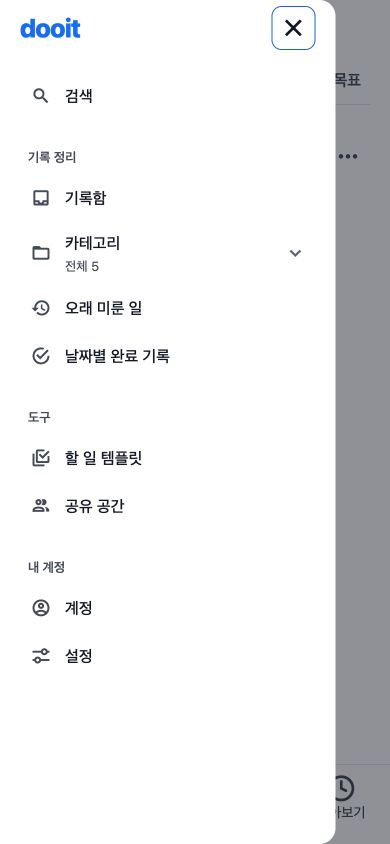
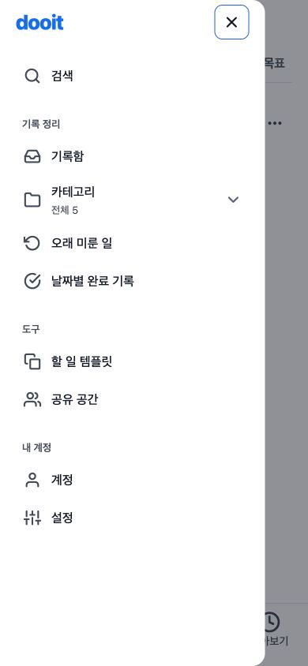

# 공통 아이콘 규격과 선형 스타일

2026-10-22 · 기준 `20b9211` 이후 working tree · VC-02 두 번째 단위 · 미커밋

## 이번 범위

- 원본: [사용자 첨부 이미지](../../design/goal-lanes-correction-2026-10-21/reference.png)를 직접 열어 단순한 선형 조작 아이콘, 원형 체크, 선택된 해와 네 탭을 확인했다.
- 유지: 흰 배경·목표색 레일/마커·원형 체크·작은 문구·탭 순서/선택 밑줄·글자·행 간격·동작·API 계약.
- 변경: 공통 `AppIcon`과 역할별 크기. 헤더/Drawer·목표 메뉴·추가/닫기·계획 항목·달력/주간 이동·개인 상세의 조작 아이콘을 연결한다. 하단 탭은 28을 유지하고 플랫폼마다 다른 선형 그림을 같은 라이브러리로 맞춘다.
- 범위 밖: 모든 legacy 화면 아이콘 일괄 교체·체크리스트/캘린더 Task 체크 형태·행/버튼·제목/본문 크기·달력 구조·새 Goal 연동.
- 완료 조건: 같은 390px·mock·문구·체크 상태로 계획/Drawer/작성 진입/상세/달력 이동을 실제 전후 비교. 탭/메뉴/닫기/날짜 이동의 이름·조작·초점과 좁은 화면을 확인한다.
- 검토: [구현 가이드](../../design/DESIGN_IMPLEMENTATION_GUIDE.md), [VC-02](../../design/VISUAL_COHESION_REVIEW_2026-10-22.md), Product Design image-to-code/audit 기준. 앞서 읽은 공식 typography/추가 프론트엔드 기준을 재사용했다. 기존 선택안 안의 보정이며 새 정보 구조 선택은 없다.

## 공통 역할

| 역할       | 크기 | 표현                                    |
| ---------- | ---- | --------------------------------------- |
| navigation | 28   | 하단 탭. 선택된 해만 기존 채움 유지     |
| list       | 24   | 헤더 메뉴·계획 항목 종류·넓은 추가 진입 |
| action     | 22   | 더보기·닫기·이전/다음·보조 메뉴         |
| meta       | 14   | 일정 메타·작은 버튼 앞 그림             |

그림 크기와 터치 크기는 분리한다. 기존 44 이상 기본 조작 영역을 줄이지 않는다. 장식 glyph는 역할별 크기를 유지하도록 font scaling을 끄고 별도 접근성 읽기에서 숨긴다. 버튼/탭의 실제 이름과 상태는 기존 컨트롤이 제공하며 `AppText`의 글자 확대는 유지한다. 자체 도형/SVG나 새 아이콘/폰트 패키지를 만들지 않았다.

기본 그림은 기존 Feather를 재사용한다. Feather에 없는 아이디어 전구와 선택된 해는 기존 Ionicons의 outline/filled를 명시적 예외로 쓴다. 원형 완료 체크는 상태 의미와 기존 동작을 보존하기 위해 이번에 교체하지 않는다.

## 실제 검증

Chrome 확장으로 기존 localhost:8082 Expo Web을 직접 조작했다. IAB는 앞선 inventory에 없어서 같은 Chrome session을 유지했다. light / mock `goal-lanes` 개발 fixture / 기본 390×844이며, 같은 두 목표·다섯 항목·완료 상태·`One step, your pace.`를 전후에 유지했다. 모든 아래 캡처는 이번 run의 실제 앱이며 저장 후 직접 열어 확인했다. 별도 Playwright CLI·Figma·새 디자인 생성은 사용하지 않았다.

| 단계         | 수정 전                                 | 수정 후                                                                   | 실제 확인                                                                                                                     |
| ------------ | --------------------------------------- | ------------------------------------------------------------------------- | ----------------------------------------------------------------------------------------------------------------------------- |
| 1. 오늘      | [01](./01-today-before.jpg)             | [17](./17-today-after.jpg)                                                | 헤더·원형 체크·선택된 해·메타 달력·넓은 추가 진입 유지. 동작/데이터 변경 없음                                                 |
| 2. 계획      | [02](./02-plan-before.jpg)              | [12](./12-plan-after.jpg)                                                 | 유형/추가 26→24, 더보기 24→22. 아이콘 폭에 따라 글자 시작이 약 2px 바뀌는 의도된 차이. 행 간격/높이 보정은 후속               |
| 3. Drawer    | [03](./03-drawer-before.jpg)            | [13](./13-drawer-after.jpg)                                               | 메뉴 이름·분류·목적지 유지. 선형 그림과 22px 조작 규격. 닫기 44×44 DOM 실측, Escape 전환 완료 후 메뉴 열기 버튼으로 초점 복귀 |
| 4. 개인 상세 | [04](./04-detail-before.jpg)            | [14](./14-detail-after.jpg)                                               | 뒤로가기/수정 그림 통일. 편집 진입→취소→상세→이전 화면 복귀를 실제 확인                                                       |
| 5. 추가 메뉴 | [05](./05-add-menu-before.jpg)          | [15](./15-add-menu-after.jpg)                                             | 일정/할 일/아이디어 이름·조작 유지. 선형 calendar/circle와 전구 outline, 아이콘 크기 22                                       |
| 6. 빠른 작성 | [06 참고](./06-quick-create-before.jpg) | [16](./16-quick-create-after.jpg)                                         | 문자 ×→공통 X. 닫기 44×44와 접근성 이름 유지, 입력 진입/닫기 확인. 아래 환경 차이 참고                                        |
| 7. 달력      | [07](./07-calendar-before.jpg)          | [10](./10-calendar-after.jpg), [연도 선택](./11-month-picker-after.jpg)   | 주 이전/다음 후 원래 날짜 복귀. 월 선택에서 연도 다음/이전 후 2026으로 복귀. 기간/선택일/3주 구조 유지                        |
| 8. 돌아보기  | [08](./08-review-before.jpg)            | [09](./09-review-after.jpg)                                               | 이전 주→이번 주 복귀 확인. 다음/이번 주 버튼의 비활성 상태 유지                                                               |
| 9. 좁은 화면 | 같은 데이터 390 기준                    | [오늘 320](./18-today-320-after.jpg), [계획 320](./19-plan-320-after.jpg) | 주요 아이콘·텍스트·탭 유지. Today document/scroll width 320으로 가로 overflow 없음                                            |

06에는 일시적인 Expo 개발 새로고침 표시가 포함돼 닫기 그림의 참고로만 쓰며, 전체 화면의 동일 조건 비교 근거로 삼지 않았다. 나머지 기본 화면은 같은 내용·viewport·펼침 상태의 전후를 함께 열어 비교했다. 생성 시안과의 비교는 흰 바탕·목표 레일·체크·선택된 해·단순한 선형 그림의 방향을 유지하는 범위이며 폰트·픽셀 전체 일치를 주장하지 않는다.

### Drawer 전후

| 수정 전 실제                           | 수정 후 실제                               |
| -------------------------------------- | ------------------------------------------ |
|  |  |

### 접근성/상태 확인

- 새 아이콘 적용 후 Web DOM/AX에서 버튼·탭의 이름/선택/비활성 상태를 확인했다. 장식 glyph의 private-use 문자가 접근성 이름에 추가되지 않는다. VoiceOver/TalkBack 전체 검사 완료를 뜻하지 않는다.
- Drawer 닫기와 빠른 작성 닫기는 실측 44×44다. 달력의 기존 연도 이동 버튼은 작은 시각 영역과 hitSlop을 유지했으며, native의 실제 터치 범위까지 이번에 검증한 것은 아니다.
- 메뉴 닫기의 전환이 끝난 뒤 초점 복귀를 확인했다. 닫는 순간의 Modal snapshot을 완료 상태로 판단하지 않았다.
- 주/월/연도와 상세 편집 취소는 UI로 조작했다. browser evaluate는 크기/문서 폭/초점 측정에만 사용했고 상태를 주입하지 않았다.
- 코드의 iOS 전용 SF Symbols 분기 대신 탭에 공통 glyph를 사용한다. 실제 iOS/Android의 glyph 로딩과 시각 결과는 미확인이다.

## 남은 차이와 검증 경계

- VC-02 전체 완료가 아니다. 제목/본문/메타의 역할과 행/버튼 규격, 새 목표 탭 노출·상세 정보 축, 달력 밀도는 후속이다. 현재 320px 가로 목표 탭의 일부 제목 노출도 이 변경으로 해결됐다고 표현하지 않는다.
- 현재 마이그레이션 대상 밖의 인증·설정·검색·템플릿·Workspace·순서 편집·체크리스트 등에는 기존 icon renderer가 남는다. 모든 앱 아이콘을 교체했다고 주장하지 않는다.
- 원형 완료 체크는 기존 MaterialCommunityIcons를 유지했다. 아이디어 전구·선택된 해는 명시적인 Ionicons 예외다. 임의의 라이브러리 혼합이 다시 늘지 않도록 이후 공통 아이콘은 `AppIcon`을 우선 사용한다.
- Android/iOS/Web 공통 영향. 실제 확인은 Web light이며 native·font scale 1.5·dark·VoiceOver/TalkBack·실제 API·전체 실패 상태는 미확인이다.
- 새 의존성·API·저장 로직 변경 없음. 시각 수치를 복제하는 새 테스트를 만들지 않고 실제 화면·조작과 저장소 필수 검사를 수행한다.
- 최종 확인 tab의 error 로그 0. hot refresh 중 한 차례 DOM 조회가 지연됐지만 동일 tab의 AX로 상태를 확인하고 다시 DOM 조회/캡처해 복구했다. 이를 앱 오류가 없다는 전체 보증으로 확대하지 않는다.
- 초기 자동 검사에서 기존 빠른 작성 요청 테스트의 UI mock에 `AppIcon`이 없어 실패했다. mock만 새 공통 컴포넌트에 맞춰 보완했고 요청 타입/본문 수용 검사는 그대로 유지했다.
- 최종 `npm run validate` 통과: typecheck/lint/format/docs/정적 release 검사와 114 suites / 591 tests, STG 1개 제외. `git diff --check` 통과. 이 결과를 실제 native/보조 기술 검증이나 전역 디자인 완료로 확대하지 않는다.

final result: passed (이번 공통 아이콘 범위, 실제 Web 확인)
