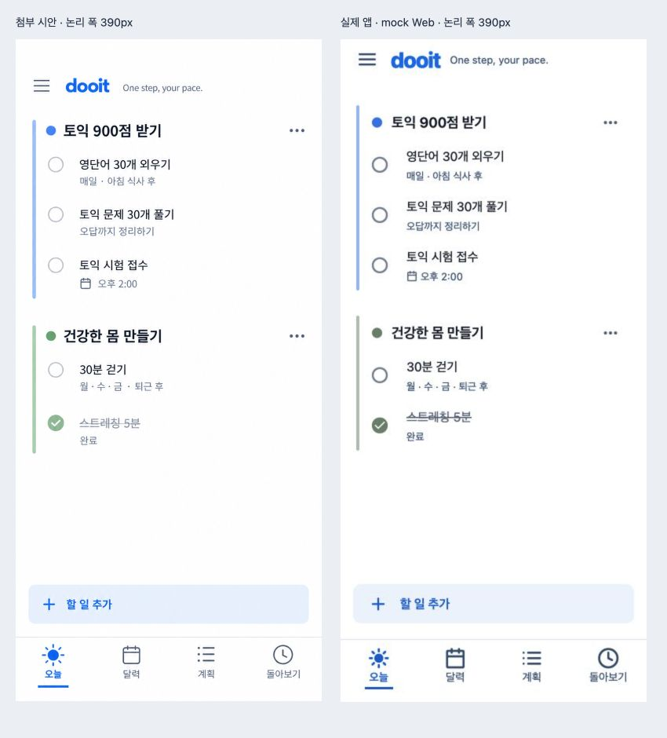

# 첨부 시안 기준 정정 — 실제 Web 감사

2026-10-21 · `479ae87` 이후 working tree · 미커밋

## 범위와 환경

[고정한 사용자 첨부 원본](../../design/goal-lanes-correction-2026-10-21/reference.png)을 기준으로 오늘 목록과 공통 탐색을 보정했다. 이전 카드형 선택은 참조 오류였으며 이번 근거로 사용하지 않는다. Product Design image-to-code/audit/design QA를 적용했다. [구현 결정·재현 명령·기능 경계](../../design/goal-lanes-correction-2026-10-21/README.md)를 함께 읽는다.

Chrome 확장 / Expo Web / light / mock / density 1. 내장 브라우저 미제공으로 앞선 감사의 Chrome을 이어 사용했다. 별도 Playwright나 브라우저 evaluate의 상태 주입은 사용하지 않았다. 서버는 독립 localhost:8082, opt-in 개발 fixture이며 실제 사용자/운영 데이터가 아니다.

## 시각 비교

왼쪽은 생성 시안, 오른쪽은 실제 앱 캡처다. 원본 853×1844를 비율 유지해 논리 폭 390, 높이 약 843으로 표시했고 실제는 390×844다. 비교 보드는 850×940에서 브라우저로 캡처했으며 원본/실제 캡처의 내용을 편집하지 않았다. 두 목표·다섯 항목·체크 상태·문구가 같다. 새 Goal API가 아닌 기존 D-Day/Task mock으로 재현한 범위다.

카드/회색 바탕·선택 pill을 제거하고 색상 레일·원형 마커·메타 줄·넓은 추가 버튼·탭 밑줄을 맞췄다. 첫 비교에서 커 보였던 본문/추가 글자를 18에서 16으로 줄이고 행 사이 여분 간격을 줄였다. 폰트 획과 sage 색·체크 선 대비·탭 label의 소폭 차이는 남아 있다. 생성 이미지의 헤더 상단 공백은 복제하지 않고 기존 52px 헤더를 유지한 의도된 차이다. 완전한 pixel 일치로 표현하지 않는다.

## 실제 확인

| 항목            | 결과 / 증거                                                                                                                              |
| --------------- | ---------------------------------------------------------------------------------------------------------------------------------------- |
| 같은 내용 390px | [최종 실제 화면](./12-today-final-390.png), 중첩 카드/가로 구분선 없음                                                                   |
| 완료 유지       | [영단어 완료 후 같은 목표에 남음](./06-completed-task-retained.png). 스트레칭 취소/재완료도 UI에서 확인                                  |
| 완료 취소       | 미완료로 복귀하고 중복 없음. 반환 todayOrder에 따라 복귀 위치가 바뀌는 기존 동작은 유지                                                  |
| 작성 진입       | [추가 메뉴](./07-add-menu.png) → 할 일 → 빠른 입력 열림 → 닫기 확인. 이번에 신규 저장/실패는 재검증하지 않음                             |
| 목표 메뉴       | [펼침과 닫기](./08-goal-menu.png). Web aria-expanded 보완, 특정 목표 자동 선택은 미연결                                                  |
| 좁은 화면       | [320px 수정 전](./09-today-320.png)의 돌아보기 잘림을 [수정 후](./11-today-320-fixed.png)에 해결. DOM 실측 width 320, 가로 overflow 없음 |
| 넓은 화면       | [430px](./10-today-430.png), DOM 실측 width 430, 가로 overflow 없음                                                                      |
| 키보드          | [Tab으로 달력 초점](./13-keyboard-tab-focus.png). 밑줄 선택과 초점 테두리 구분, 초점 잘림 없음                                           |
| 계획/상세       | [계획 흰 바탕](./14-plan-flat.png), [개인 상세](./15-task-detail-flat.png)를 다시 캡처. 상세 왕복 확인                                   |
| Console         | 최종 responsive tab의 error 로그 0. 전체 warning 제거를 뜻하지 않음                                                                      |

## 비교 이력과 판정

`01` 첫 보정 → `02` 색/상태 → `03` 글자 18px → `04` 첫 비교 → `05` 글자·밀도 조정 → `06–08` 조작 → `09–11` 반응형 보정 → `12` 최종 오늘 → `13–15` 공통 초점/계획/상세 → `16` 최종 비교다. 초기 캡처는 최종 기준이 아니다.

이 범위의 시각 참조 오류와 320px 탐색 잘림을 수정했다. **현재 Today 시각 보정의 local Web QA는 passed**다. 새 Goal 회차/연결 Task/주간 여정 전체 사용자 흐름은 여전히 미완료이며 이 판정에 포함하지 않는다. 완료만 있는 날과 중복/그룹 로직은 자동 검사로 보완했으나 긴 제목을 포함해 이번 브라우저에서 모든 빈/오류/대량 상태를 재현한 것은 아니다.

`npm run validate` 통과: 113 suites / 589 tests, STG 1개 제외. 소스 변경 후 실행했으며 문서 갱신 뒤 format/docs/diff 검사를 별도로 확인한다.

영향: Android/iOS/Web 공통. 미확인: native safe area·font scale 1.5·VoiceOver/TalkBack·dark·실제 API/오류·장시간 세션. 기존 [전체 감사](../whole-app-2026-10-21/README.md)의 기능 이슈와 [로드맵](../../product/ROADMAP.md)은 유지한다.
