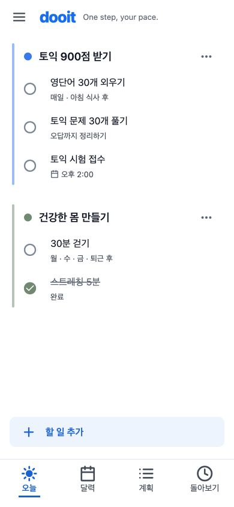

# 공통 보조 텍스트·아이콘 색상

2026-10-22 · 기준 `a3943d2` 이후 working tree · VC-02의 첫 단위 · 미커밋

## 이번 변경 범위

- 원본: [사용자 첨부 이미지](../../design/goal-lanes-correction-2026-10-21/reference.png)를 직접 열어 흰 바탕·주/보조 정보·파란 선택과 목표색의 역할을 확인했다.
- 유지: 목표 레일/마커·원형 체크·헤더와 작은 문구·네 탭, 글자/아이콘 크기·간격·동작·저장 계약.
- 변경: 공통 light theme의 `textSecondary`, `textMuted`를 중립색 토큰으로 연결. 기존 `AppText`·버튼·아이콘·탭이 같은 의미의 색을 공유하도록 한다.
- 범위 밖: 새로운 레이아웃·달력 구조·전역 아이콘/행 크기·폼·목표 기능 연결·dark 팔레트 재설계.
- 완료 조건: 같은 390px·mock 데이터·문구·체크 상태로 오늘/계획/달력/돌아보기의 수정 전후를 실제 캡처. 좁은 화면과 기존 선택/비활성 색·텍스트 대비를 확인하고 미확인 플랫폼을 기록.
- 검토: [구현 가이드](../../design/DESIGN_IMPLEMENTATION_GUIDE.md), [VC-02 색 역할](../../design/VISUAL_COHESION_REVIEW_2026-10-22.md), Product Design audit 기준을 적용한다. 기존 원문 자료는 앞선 검토 기록을 재사용했다. 기존 선택안 안의 색 보정이며 새로운 3안 선택이 필요한 정보 구조 변경은 아니다.

## 색의 역할

| 역할                            | 기존                              | 이번 적용                       |
| ------------------------------- | --------------------------------- | ------------------------------- |
| 주 텍스트                       | `text`, 짙은 slate                | 유지                            |
| 보조 정보/기본 아이콘/비활성 탭 | `textSecondary`, #425E82          | `palette.neutral[600]`, #4B5563 |
| 더 낮은 위계/완료/placeholder   | `textMuted`, #607088              | `palette.neutral[500]`, #667080 |
| 브랜드/선택/주 행동             | `brand`, `primary`, `primarySoft` | 유지                            |
| 목표 식별                       | 사용자 목표색                     | 유지                            |
| 성공/경고/오류                  | 의미별 theme 색                   | 유지                            |

같은 보조 색을 쓰는 화면 전체에 영향이 있다. 기존 컴포넌트의 색 역할을 바꾸지 않으며, 변경 결과를 화면별로 임의의 hex로 덮어쓰지 않는다.

## 실제 확인

Chrome 확장으로 localhost:8082의 Expo Web / light / mock `goal-lanes` 개발 fixture를 직접 조작했다. IAB는 앞선 inventory에서 제공되지 않아 기존 Chrome 비교 tab을 이어 사용했다. 이번에는 Playwright CLI를 사용하지 않았다. 같은 두 목표·다섯 Task·완료 상태·`One step, your pace.`를 유지하며 390×844로 수정 전후를 캡처했고 파일을 직접 열어 비교했다. native/운영 데이터의 증거가 아니다.

| 단계         | 판정                                                                                                   | 수정 전                        | 수정 후                        |
| ------------ | ------------------------------------------------------------------------------------------------------ | ------------------------------ | ------------------------------ |
| 1. 오늘      | 통과: 목표 레일·원형 체크·완료 상태·단일 추가와 헤더 위치 유지. 메타/메뉴/비활성 탭만 중립색           | [01](./01-today-before.jpg)    | [08](./08-today-after.jpg)     |
| 2. 계획      | 통과: 선택 목표·목표일·목록 위치 유지. 큰 유형 아이콘·메타·추가 행의 보조 색이 공통으로 반영           | [02](./02-plan-before.jpg)     | [07](./07-plan-after.jpg)      |
| 3. 달력      | 통과: 같은 10월 22일·3주 범위·예정 4개·완료 1개. 오늘 날짜와 선택 탭·일정 시각 강조는 파랑 유지        | [03](./03-calendar-before.jpg) | [06](./06-calendar-after.jpg)  |
| 4. 돌아보기  | 통과: 같은 주·같은 완료 기록. 목표 식별색 유지, 주 탐색의 비활성 상태/보조 기록 색 보정                | [04](./04-review-before.jpg)   | [05](./05-review-after.jpg)    |
| 5. 좁은 화면 | 통과: 320×844, 측정한 document width/scrollWidth 320으로 가로 overflow 없음. 헤더·목표·추가·네 탭 유지 | 같은 데이터의 기존 390 화면    | [09](./09-today-320-after.jpg) |

DOM computed color도 확인했다. 돌아보기의 보조 문구와 비활성 탭 label은 `rgb(75, 85, 99)`이며 선택 탭 label은 기존 `rgb(23, 105, 224)`다. 코드의 공통 색상 변경이 실제 화면에 적용됐고 상태별 의미가 유지됨을 확인한 범위다. 새 저장 동작이나 오류 복구 흐름을 검사한 것은 아니다.

## 대비와 시각 판정

| 전경                  | 흰 바탕 | muted 바탕 #F8FAFC |
| --------------------- | ------- | ------------------ |
| textSecondary #4B5563 | 7.56:1  | 7.22:1             |
| textMuted #667080     | 5.01:1  | 4.79:1             |

같은 viewport·내용의 실제 전후를 함께 열어 정보 위계와 선택 색을 비교했다. 원본 시안의 흰 바탕·목표색·파란 주 행동을 유지하면서, [승인된 완성도 개선 방향](../../design/VISUAL_COHESION_REVIEW_2026-10-22.md)의 ‘보조 정보는 중립색’을 적용했다. 원본의 모든 픽셀/폰트를 복제했다고 주장하지 않는다. 이번 차이는 같은 구조 안의 의도된 색 보정이다.

실제 핵심 조작은 네 탭 전환과 현재 상태 보존을 확인했다. 초기 달력 도움말은 비교 전에 UI로 닫고 수정 전후 동일하게 유지했다. browser evaluate는 computed color와 viewport/문서 폭 측정에만 사용했고 상태/데이터를 주입하지 않았다.

## 남은 차이와 한계

- VC-02 전체 완료가 아니다. 계획의 큰 유형 아이콘, Today와 Calendar의 행/체크 형태, 페이지별 제목·버튼 위계는 다음 단위다. 달력의 빈 그리드 크기와 새 Goal 연결은 별도 후속이다.
- Android/iOS/Web 공통 light theme에 영향이 있다. 실제 화면은 Web light만 확인했다. native·font scale 1.5·dark 실제 화면·VoiceOver/TalkBack·운영 API는 미확인이다. dark 색상은 이번에 변경하지 않았다.
- 텍스트/아이콘/비활성 탭 등 공통 토큰을 쓰는 화면 전체에 영향이 있으나 로그인·Workspace·설정 등의 모든 상태를 새로 캡처한 것은 아니다. 실패/복구·권한·알림 검증을 완료로 처리하지 않는다.
- 새 의존성·API/저장 계약·화면 구조 변경이 없으며, 시각 값을 복제하는 테스트는 추가하지 않았다. 기존 light/dark 대비 회귀 검사와 저장소 필수 검증을 실행한다.
- 최종 tab의 error 로그 0. 모든 warning/네트워크 오류 검사를 뜻하지 않는다.
- `npm run validate` 통과: typecheck/lint/format/docs/정적 release 검사, 114 suites / 591 tests, STG 1개 제외. 기존 light/dark 대비 검사 포함. `git diff --check` 통과. 이 자동 결과를 전역 시각 완성도/접근성 전체 승인으로 사용하지 않는다.

final result: passed (공통 보조 색상, 실제 Web 범위)
