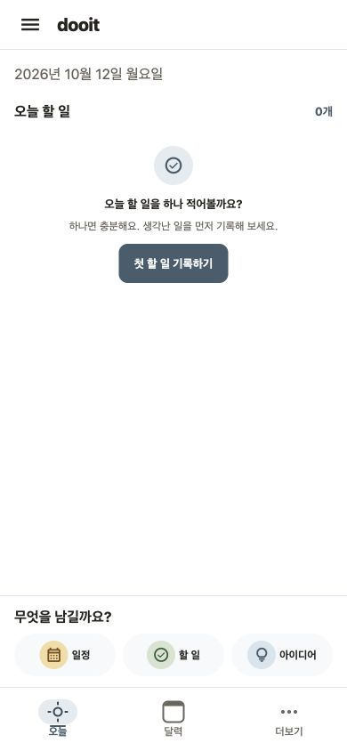
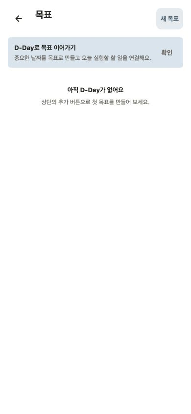
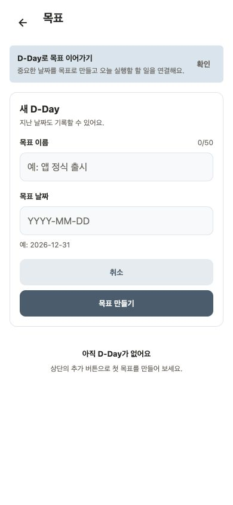
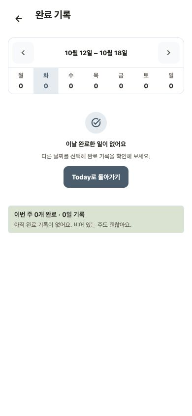
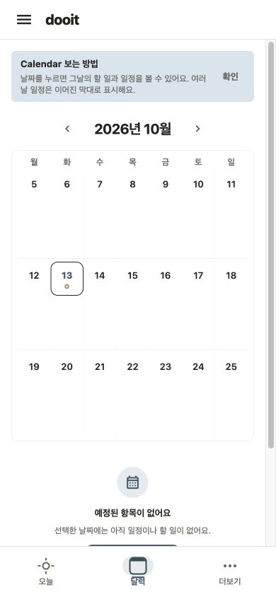

# 화면 필요성·위치에 대한 Product Design 감사

검토일: 2026-10-12–13 · 대상: `main` / `6fd5293` · 제품 코드 변경 없음

## 범위와 결론

오늘→더보기→목표→목표 작성→완료 기록→템플릿→공유 공간을 탐색하고, 소스에서 확인한 오늘 계획·하루 마감·달력 경로도 열어 비교했다. 빈 상태의 정상 탐색은 가능하지만, 계정·작업 도구의 혼합과 목표/정리/회고의 역할 구분에 개선이 필요하다. [전체 제품 구조 제안](../../product/PRODUCT_ARCHITECTURE_REVIEW_2026-10-13.md)에 페이지별 유지·통합·이동 판단과 레퍼런스, 개발 순서를 정리했다.

## 실행 환경과 한계

- Expo Web, mock API override, 로컬 게스트, Chrome 확장, 390×844, light, Asia/Seoul. 실제 계정·운영 데이터를 수정하지 않았다.
- 기본 내장 브라우저는 생성·연결 재시도에도 unavailable이었다. 기존 로컬 8092의 연결 실패 후 mock Metro 8095를 실행해 Chrome의 전용 검토 탭을 사용했다. 기존 로그인 탭과 로컬 Playwright는 사용하지 않았다.
- 같은 브라우저에서 DOM snapshot으로 위치를 확인하고 Enter로 탐색했다. AX/클릭 전달이 불안정한 환경이므로 전체 native pointer/keyboard 사용성 통과로 판단하지 않는다.
- 01–02는 검토 시작 당시 10월 12일 날짜를 보여준다. 이어서 확인한 달력은 10월 13일이다. 원본 날짜를 바꾸지 않았다. 이전에 열린 Today 날짜와 새로 연 달력 날짜의 차이는 기존 날짜 갱신 검증 항목과 함께 추적한다. 모든 자정/복귀 시나리오 재현을 완료한 것은 아니다.
- 모든 PNG는 이 감사 실행에서 캡처·저장하고 정확히 같은 파일을 열어 확인했다. 03–10은 이어서 진행한 검토에서 추가했다. 폴더 날짜는 시작일이다.
- 공유 공간은 게스트 로그인 요구까지만 확인했다. 인증 뒤 목록·권한·초대는 미검증이다. 계획·마감은 빈 상태만 확인했다.
- 소스 기반 역할 검토는 로그인·가입·설정·검색·Task 상세·공유 수신까지 확장했으나 이 화면들을 이번에 직접 캡처한 것으로 주장하지 않는다.
- console에는 shadow style deprecation 경고가 있었다. 성능 수치·실기기·dark·320/430px·큰 글꼴·screen reader·네트워크 실패·대량 데이터는 미검증이다.

## 1. 오늘 — 실행 진입 가능, 위계 개선 필요

장점: 첫 할 일을 바로 만들 수 있고 빈 상태 문구가 부담을 낮춘다. 중간 문제: 로고·날짜, 큰 빈 공간, 작성 dock, 하단 탭이 각기 층을 차지한다. 현재 화면에 주간 달력은 없다. 실행 내용 중심으로 header와 작성 진입을 줄인다. 아이콘을 작게 바꾸더라도 hit target을 줄이지 않아야 한다. 동적 글꼴은 미검증이다.

## 2. 더보기 — 이동 가능, 목적지의 위계 재검토

장점: 목적지마다 설명이 있다. 중간 문제: 계정 카드·게스트 안내가 먼저 나오고 완료 기록·공유 공간·설정이 그 아래에 섞인다. 하단 세 자리 중 한 자리를 차지할 핵심 사용 목적이 불분명하다. 계정은 계정 진입으로, 템플릿은 작성으로, 기록은 돌아보기로 이동을 제안한다. 파란 테두리는 focus 표시로 보존 대상이다. 긴 글꼴 상태에서 설정 접근은 미검증이다.

## 3. 목표 — 정상 표시, 명칭의 범위가 큼

장점: D-Day와 오늘 행동을 연결한다는 설명이 있다. 중간 문제: 화면 이름 목표가 사용자의 모든 바람을 담을 것처럼 보이지만 실제 기능은 날짜 목표다. 날짜 목표로 범위를 좁히고 새로운 바람/시스템은 별도로 연결한다. 초기 안내는 닫을 수 있다. 데이터가 있는 상태는 미검증이다.

## 4. 목표 작성 — 입력 가능, 날짜 없는 방향에는 부적합

장점: 이름·날짜의 짧은 입력과 취소가 있다. 중간 문제: 바람 발견의 시작으로 쓰면 목표 날짜부터 요구하게 된다. D-Day 기능 자체는 보존하되 시스템의 기본 객체로 재사용하지 않는다. 작성창을 열고 취소만 했으며 저장 validation·키보드 가림은 미검증이다.

## 5. 완료 기록 — 주별 탐색 가능, 증거 표현 확장 필요

장점: 주간 이동과 날짜별 완료 수, 기록이 없는 주를 존중하는 문구가 있다. 중간 문제: 숫자와 날짜 선택이 먼저이고 실제 한 일을 돌아보는 구조는 약하다. 주간의 실제 기록을 먼저 보여주고 날짜별 원본으로 내려가게 제안한다. Today 영문 혼용도 정리한다. 원본·집계 정합성은 빈 상태 캡처만으로 판정할 수 없다.

## 6. 템플릿 — 도구로 유효, 독립 탐색 우선순위 낮음

장점: 재사용 목적과 생성 진입이 명확하다. 중간 문제: 기록을 추가하려는 맥락과 분리되어 더보기에서 먼저 도구를 찾아야 한다. 작성에서 가져오기와 관리로 연결한다. 반복 시스템과 일회성 복제의 차이를 안내한다. 데이터가 있는 상태·실제 적용은 미검증이다.

## 7. 공유 공간 — 게스트 제한 정상 표시, 내부 흐름 미검증

장점: 로그인 필요와 다음 행동을 설명한다. 제한: 이 상태로 공유 공간의 필요성·실제 협업 UX를 평가할 수 없다. 개인 방향을 이유로 기능을 제거하지 않고 계획의 공간 전환으로 접근을 유지하는 제안만 한다. 인증·역할별 접근성은 별도 확인한다.

## 8. 오늘 계획 — 빈 상태 정상, 회고와 구분 필요

장점: 고를 항목이 없을 때 종료할 수 있다. 중간 문제: route의 review와 달리 사용자 역할은 앞으로 할 일 선택이다. 계획 아래에 두고 회고와 분리한다. populated 상태의 추천·기록함·focus 순서는 코드 기반 검토이며 이번 캡처에서는 미확인이다.

## 9. 하루 마감 — 빈 상태 정상, 독립 의식 강요를 피할 필요

장점: 미완료 항목이 없으면 추가 입력을 요구하지 않는다. 중간 문제: 첫 설명이 끝내지 못한 일의 이동부터 시작한다. 돌아보기 안에서 필요한 경우에만 다음 일정을 정하도록 제안한다. 실제 미완료 이동과 부분 실패는 미검증이다.

## 10. 달력 — 접근은 좋음, 선택일 내용이 밀림

장점: 하단 탭 한 번으로 열리고 날짜 이름·오늘 상태를 제공한다. 중간 문제: 빈 3주 grid가 대부분을 차지하며 선택일 CTA는 하단에 걸린다. 월 제목과 실제 표시 범위도 어긋나 보인다. compact 날짜 선택과 선택일 목록을 비교한다. 달력 이동은 접근성 저하가 없도록 별도로 검증한다. 날짜 hit target·대량/다일 일정·screen reader는 미검증이다.

## 후속 우선순위

1. 탐색 구조 A/B/C의 시각 비교와 선택: 더보기 대체, 달력 접근, 돌아보기 역할.
2. 선택된 방향의 header·하단 탭·작성 진입·아이콘/용어 정돈.
3. 앞선 감사의 빠른 기록 유형 불일치와 날짜 복귀 문제 재현·수정. real API도 확인.
4. 시스템 실행 3번 sheet와 주간 증거 연결. 원본 근거·휴식/최소 행동·실패 복구 검증.

이번 검토에는 발견된 문제를 제품 코드에서 수정하는 작업이 포함되지 않았다. 구현 후에는 새 캡처와 접근성·실패 상태 검증이 필요하다. 개발 검증 결과는 아래에 이어 기록한다.

## 개발 검증 결과 — 2026-10-13

- `npm run validate`: typecheck·lint·format·문서 링크 통과 후 대표 screenshots 최신성 검사에서 실패. 2026-09-13 캡처가 30일이 되어 갱신 기준에 도달했다. 감사용 부분 캡처로 manifest 날짜만 바꾸지 않았다.
- 이후 별도 실행한 `npm run check:release-static` 통과, `npm test` 98 suites / 498 tests 통과.
- `git diff --check` 통과. UI 코드·의존성·API 계약 변경 없음. Android/iOS/Web 제품 동작 변경 없음; 직접 화면 관찰은 Web에 한정.
- 검토용 viewport override 해제, 이번 작업의 mock Metro 종료. 새 문서·캡처는 미커밋이며 push하지 않았다.
