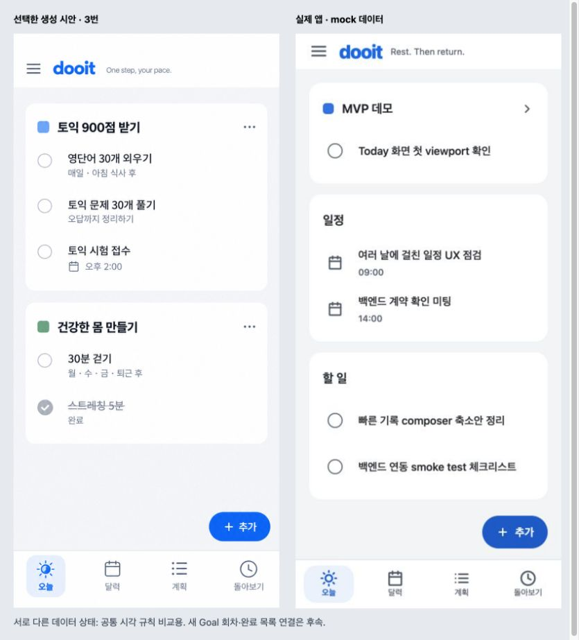

# 선택한 목표 묶음 디자인 — 첫 적용과 흐름 검토

2026-10-21 · `ddde85b` 이후 working tree · light / mock API / Chrome extension

선택 시안과 전체 화면 수정 규칙은 [디자인 결정](../../design/soft-goal-surfaces-2026-10-21/README.md)에 있다. 이번 구현은 기존 오늘 Task 묶음·메타 정보·공통 탭·글자 색이다. 새 Goal 회차/완료 유지/전체 여정 연결이나 전체 앱 리디자인 완료가 아니다.

## 환경과 확인 경계

- 기존 Chrome 연결을 이어 사용했다. 내장 브라우저가 이전 작업에서 제공되지 않았던 fallback이며 다른 browser나 standalone Playwright로 전환하지 않았다.
- 기존 게스트 세션으로 새 Goal 계획/오늘 빈 상태, 별도 로컬 mock 데모 세션으로 기존 D-Day/Task/일정/완료 기록을 확인했다. 두 세션의 데이터를 하나의 사용자 여정으로 합쳐 설명하지 않는다.
- 기준 viewport 390×844, 좁은 320×844, 넓은 430×844. 새 탭의 초기 desktop 캡처는 비교에서 제외하고 `04`를 390으로 재촬영했다.
- Product Design image-to-code/audit/design-qa, Anthropic frontend-design 원문, Vercel React Native의 Pressable/styling/safe-area 규칙, Web Interface Guidelines를 적용했다. 외부 스킬 신규 설치·Figma 파일 검토·별도 전문가 승인을 수행한 것은 아니다.
- native safe area, 글자 배율 1.5, VoiceOver/TalkBack, dark 화면, 실제 API 오류/지연은 미확인이다. 네트워크 실패/복구 상태를 이번 시각 감사로 통과 처리하지 않는다.
- 일부 화면의 번개 표시는 Expo 개발 overlay로 제품 구성에서 제외했다.

## 실제 흐름과 판단

| 단계 | 화면/행동                                                              | 상태와 후속                                                                            |
| ---- | ---------------------------------------------------------------------- | -------------------------------------------------------------------------------------- |
| 1    | [새 Goal의 계획](./01-plan.png) → [오늘 빈 상태](./02-today-empty.png) | 반복 정의는 있으나 오늘 미연결. 색 변경만으로 해결되지 않는 F3a-2 과제                 |
| 2    | [기존 실제 mock Task 목록](./15-today-final.png)                       | 목표·일정·일반 할 일을 흰 묶음으로 표시. 제목 아래 시각, 단순 체크 영역 유지           |
| 3    | [할 일 상세](./05-detail.png)                                          | 진입·복귀 정상. 빈 체크리스트 0/0, 없음 메타, 중첩 카드의 위계는 다음 디자인 작업      |
| 4    | [추가 메뉴](./06-add-menu.png)                                         | 통합 진입 정상. 메뉴 열기/닫기 확인. 오늘 작성의 저장 목적지 개선은 별도 잔여          |
| 5    | [달력](./10-calendar.png)                                              | 탭 이동 정상. 3주 그리드의 큰 빈 칸, 잘린 일정 제목, 선택일 목록이 밀리는 문제 유지    |
| 6    | [계획](./11-plan.png)                                                  | 기존 목표/연결 항목 조회 정상. 오늘과 다른 역할을 보여줄 목표 구성·편집 구조 보정 필요 |
| 7    | [돌아보기](./13-review.png)                                            | 실제 mock 완료 기록 조회 정상. Goal Journey와 직접 기록은 아직 미연결                  |
| 8    | [320](./08-today-320.png) / [430](./09-today-430.png)                  | 제목 줄바꿈, 추가 진입·네 개 탭 유지. 320의 돌아보기 탭 56×55, label 높이 18 확인      |
| 9    | [키보드 초점 수정 후](./14-tab-focus-fixed.png)                        | Tab으로 돌아보기 이동, 실제 outline이 잘리지 않고 표시. 네이티브 보조 기술 검증은 별도 |

## 시안 비교와 수정 이력

왼쪽 생성 시안 853×1844를 브라우저에서 폭 390으로 비율 유지 표시했다(높이 약 843). 오른쪽 실제 캡처는 390×844, density 1이다. 비교 보드 자체는 850×940이다. 데이터와 기능 상태가 달라 **전체 내용·행 개수의 1:1 재현 통과로 판단하지 않는다**. 원본의 두 Goal/완료 항목과 실제 기존 Goal/일정/일반 일 세 묶음의 차이를 명시한다.

1. [초기 `01`/`02`](./01-plan.png): 하단 탭 높이 변경 뒤 label이 잘리고 선택 배경이 사각형으로 보임. P1. 아이콘 wrapper/label flex와 여백을 조정하고 선택 배경의 radius를 적용했다.
2. [중간 `12`](./12-tab-keyboard.png): outer overflow로 키보드 outline이 보이지 않음. P1. navigator의 href/role/selected/press handling을 그대로 전달하는 `PlatformPressable`에 radius를 적용하고 outer clipping 제거. [후속 `14`](./14-tab-focus-fixed.png)에서 초점 확인.
3. [중간 `04`](./04-today-populated.png): Web 세로 scrollbar가 목록 폭을 줄임. P2. 오늘 스크롤 indicator를 숨기고 [최종 `15`](./15-today-final.png)의 좌우 20/350 폭을 확인했다. 추가 버튼의 그림자도 제거했다.

## 다섯 시각 기준

- **글자**: 기존 플랫폼 sans-serif, 본문 16/24, 목표 18/26 semibold, 보조 13/18. 생성 이미지의 정확한 폰트 파일은 알 수 없다. 탭은 12/18이며 잘림 수정 후 확인했다.
- **배치**: 목표당 radius 18의 surface, padding 16, 묶음 간 16, 행 최소 64. 생성 이미지 상단의 과도한 여백은 기존 사용자 지시에 따라 복제하지 않고 header 52를 유지했다.
- **색**: light의 회색 바탕과 흰 묶음, 중립 보조 글자, 파란 주요 행동/선택. 체크박스는 시안보다 진하게 하여 식별성을 확보했다. dark는 기존 대응 색을 보존하되 시각 검증은 후속이다.
- **이미지/아이콘**: 새 raster asset 없이 기존 wordmark·Feather/SF Symbols 활용. 실제 일정은 체크 가능한 할 일과 달라 calendar glyph를 유지한다. 시안의 ellipsis 대신 현재 동작에 맞는 목표 이동 chevron을 유지했다.
- **내용**: 실제 기존 mock의 개발용 제목을 변경하지 않았다. 새 Goal, 반복 회차, 완료 유지가 연결되지 않은 것을 시안 예시로 가리지 않았다.

## 남아 있는 제품 문제

디자인 우선으로 계획/상세/폼의 공통 구조를 이어 정리한다. 기능 측면에서는 계획→오늘 회차, 목표 제목→해당 목표 선택, 오늘 작성→오늘 배치, 체크→완료 유지/취소, 실제 Goal 여정을 연결해야 한다. 각 코드 근거와 계약 경계는 [수정안의 연결 과제](../../design/soft-goal-surfaces-2026-10-21/README.md)에 둔다.

## 검증 결과

- 실제 Web: 목록·상세 진입/복귀·추가 메뉴·네 탭 이동·키보드 초점·320/390/430 확인. 기록된 browser console error 0.
- 자동 검증: `npm run validate` 통과. TypeScript/lint/format/docs/release static 검사 및 112 suites / 584 tests 통과, STG integration 1개 제외. `git diff --check` 통과. 스타일을 그대로 반복하는 새 테스트는 추가하지 않았다.
- Android/iOS/Web 공통 변경. native 실제 실행/보조 기술/확대 검증은 미실시.
- 전체 선택 시안의 완료 조건은 새 Goal/완료 목록이 연결된 같은 데이터 상태 비교까지이며 현재 충족하지 않았다. 첫 시각 보정과 전체 디자인 완료를 구분한다.
