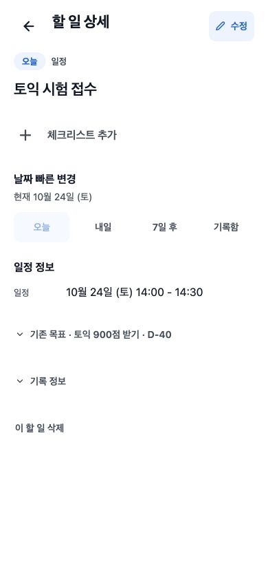

# 상세 화면 디자인 재검토

2026-10-24 · `5e6463f` 이후 미커밋 상세 보정 상태 · 사용자 추가 검토

## 판정

**현재 상세 화면을 최종 디자인으로 확정하는 것은 권하지 않는다.** 앞선 [정렬 보정](../task-detail-alignment-2026-10-24/README.md)의 passed는 명시한 정렬·상호작용 검사 통과다. 정보 순서·관리 기능의 비중·상세에서의 완료 행동까지 제품 디자인의 최종 완성도를 승인한 뜻이 아니다. 정렬만 다듬고 같은 레벨의 여러 섹션을 남긴 한계가 있다.

이번에는 앱 코드를 추가 수정하지 않았다. 기존 미커밋 변경은 보존하고, 구조 재검토를 다음 일반 목록 제목 작업보다 먼저 둔다. 신규 구조를 임의 구현하지 않고 시각안 세 개를 비교한다. 오늘/계획/달력/돌아보기의 역할과 확정된 흰 배경·목표색·단순 체크는 유지한다.

## 범위·확인 수준

- 대상/목적: 휴대폰 사용자가 할 일의 목표 맥락·실제 일정·실행 내용을 파악하고 수정/완료하는 개인 상세. 서비스 전체 재감사가 아니다.
- 적용: Product Design index/audit/research 기준, 저장소 검토 정책과 구현 가이드. ideate 지침도 확인했지만 이번 질문은 평가/비교이므로 새 시안 생성·코드 구현은 하지 않았다. 새 frontend-design 스킬 설치/실행이나 Figma 작업은 없다.
- 실제 앱: 동일 Chrome 확장, localhost:8082/tasks/4, design fixture/mock/light, 390×844. 이전 관리 탭이 정리돼 같은 Chrome에 새 탭을 열었다. IAB/Playwright 전환은 없다. [01 이번 실제 캡처](./01-current-detail-390.jpg)를 저장 후 직접 열었다. 테스트 데이터를 추가하지 않았다.
- 외부 자료: 2026-10-24 아래 공식 도움말/설계를 읽었다. Todoist 공식 페이지에서 Android 플랫폼을 직접 선택해 설명을 확인했다. 원본 모바일 이미지 CDN은 web fetch 오류, 브라우저 다운로드 파일은 지원 이미지로 열리지 않아 시각 근거에서 제외했다. 경쟁 앱에 로그인하거나 실기기 픽셀을 비교한 감사는 아니다. TickTick은 검색에 색인된 공식 설명까지 확인됐지만 본문 추출이 비어 핵심 판정 근거로 쓰지 않았다.

## 1. 현재 상세 — 정렬 개선, 정보 위계 추가 수정 필요

| 관찰                                                                                              | 영향/판단                                                                                                                  | 우선순위·추천                                                                                                              |
| ------------------------------------------------------------------------------------------------- | -------------------------------------------------------------------------------------------------------------------------- | -------------------------------------------------------------------------------------------------------------------------- |
| 제목 아래에 빈 체크리스트 추가, 날짜 빠른 변경, 일정 정보, 기존 목표, 기록, 삭제가 차례로 놓인다. | 내용과 관리 행동이 같은 수준으로 보여 설정 목록 같은 인상이 강하다. 여백이 많아도 의미가 묶이지 않는다.                    | 높음: 목표 맥락·제목·현재 날짜/시간을 먼저 묶고 내용과 관리를 구분한다.                                                    |
| 14:00~14:30이라는 일정은 날짜 빠른 변경 버튼 네 개보다 아래다.                                    | 항목을 확인하러 들어온 사용자가 실제 일정보다 변경 도구를 먼저 읽는다.                                                     | 높음: 실제 날짜/시간을 제목 가까이 노출하고 해당 필드를 눌러 변경하는 흐름 비교.                                           |
| 연결 목표가 하단 접기 행에 있다.                                                                  | 목표 아래의 행동이라는 핵심 맥락이 제목과 떨어진다.                                                                        | 높음: 제목 근처의 작은 목표 경로/링크로 표시. Goal/D-Day 구분과 지원 범위는 유지하고 연결되지 않은 데이터를 꾸미지 않는다. |
| 제목 옆이나 본문에 할 일 자체의 완료 조작이 없다.                                                 | 상세에서 행동을 마친 경우 목록으로 돌아가 체크해야 한다. AX/현재 코드상 직접 진입 부재이며 사용 빈도를 측정한 것은 아니다. | 중간: 제목 옆 원형 체크를 비교. 반복 회차/완료 취소/오류 동작은 기존 hook·계약을 확인한 뒤 연결한다.                       |
| 기록·삭제가 각각 44 이상 전체 행과 섹션 간격을 차지한다.                                          | 자주 읽는 내용보다 관리 도구의 시각 비중이 커진다.                                                                         | 중간: 이름 있는 접근 가능한 더보기 메뉴로 관리. 삭제 확인과 기록 접근은 유지하며 제스처에만 숨기지 않는다.                 |
| 상단의 ‘할 일 상세’, 오늘 배지, 유형, 본문 제목이 각각 레벨을 갖는다.                             | 실제 내용보다 화면 종류/분류를 여러 번 강조한다.                                                                           | 중간: 제목을 주인공으로, 분류/상태는 보조 맥락으로 축소하는 안 비교. 큰 색 카드로 대체하지 않는다.                         |

이 평가는 한 로컬 일정 사례에 대한 전문가 설계 판단이다. 사용자 빈도·전환율·선호를 검증한 결과나 전체 접근성 적합 판정이 아니다. 긴 제목/빈 상태/할 일/아이디어/완료·오류 상태에서도 같은 구조가 성립해야 한다.

## 공식 서비스와 비교한 근거

| 자료                                                                                                                                                       | 확인한 사실                                                                                                                     | Dooit에 가져올 원칙                                                                                                                                                      |
| ---------------------------------------------------------------------------------------------------------------------------------------------------------- | ------------------------------------------------------------------------------------------------------------------------------- | ------------------------------------------------------------------------------------------------------------------------------------------------------------------------ |
| [Todoist task view 공식 도움말](https://www.todoist.com/help/todoist/features/use-the-task-view-to-manage-tasks-in-todoist-eDeRDO0C), 2026-08-28 갱신 표기 | 모바일에서 목표/섹션 경로로 이동하고 날짜 필드를 눌러 날짜·시간·기간을 수정한다. 활동 기록과 삭제는 우측 상단 작업 메뉴에 있다. | 맥락은 직접 읽고, 날짜는 정보 자체를 조작한다. 낮은 빈도의 관리는 메뉴로 묶는다. 댓글·담당자·우선순위 등의 기능은 그대로 복제하지 않는다.                                |
| [Things 공식 기능 소개](https://culturedcode.com/things/features/), Beautiful To-Dos                                                                       | 할 일을 열면 흰 종이처럼 내용을 담고, 태그/체크리스트/시작일/마감일 같은 부가 필드는 필요할 때 사용하게 배치한다고 설명한다.    | 흰 바탕을 유지하되 모든 기능을 큰 섹션으로 펼치지 않는다. 노트/실행 내용을 중심에 둔다. 제품 소개의 설계 설명이며 현재 모바일의 세부 수치/정확한 배치를 입증하지 않는다. |
| [Things 일정 구분](https://culturedcode.com/things/support/articles/2803579/)                                                                              | 시작일은 착수 시점, 마감일은 완료해야 하는 시점으로 설명한다.                                                                   | 같은 ‘날짜’로 뜻이 다른 필드를 섞지 않는다. 아래 계획일/실제 일정 구분을 먼저 해결한다.                                                                                  |
| [Todoist task view 설계 소개](https://www.todoist.com/inspiration/todoist-new-task-view)                                                                   | 내용과 속성을 구분하고 사용 빈도에 맞춰 속성을 재배열한 설계를 설명한다.                                                        | 모든 행의 정렬을 맞추는 데 그치지 않고 읽는 내용/자주 쓰는 행동의 순서를 정한다. Desktop sidebar를 모바일에 복사하지 않는다.                                             |

## 추천 방향과 구현 전 조건

추천은 **내용 중심의 단일 상세 화면**이다. 제안 순서는 작은 연결 목표 경로 → 전체 제목/완료 체크 → 현재 실행일과 일정 시간 → 실제 설명/체크리스트다. 수정·날짜는 바로 찾을 수 있게 남기고 기록·삭제 등 관리 행동은 더보기에서 접근한다. 단일 화면/전체 페이지·현재 날짜 행을 유지하는 보수안, 내용 중심안, 요약+필드 편집안 세 가지를 같은 데이터·390×844로 비교한 뒤 사용자 선택을 받는다. 이 문서의 추천을 시안 선택 완료로 취급하지 않는다.

날짜 UI를 줄이기 전에 계약을 구분해야 한다. 현재 빠른 변경은 `plannedDate`를 옮기며 일정의 `startAt/endAt`은 유지한다. 따라서 ‘내일’이 시험 일정 자체를 옮긴다는 오해를 만들 수 있다. **실행일과 실제 일정이 다른 개념이면 명칭과 편집 동작을 분리**하고, 같은 날짜처럼 묶어 표시하지 않는다. 시간 예약을 바꾸는 새 동작은 기존 편집 API/폼을 사용하거나 필요한 요청을 먼저 문서화한다.

접근성 조건은 최소 터치 영역·긴 제목 줄바꿈·확대 재배치·목표/날짜/체크의 이름·선택 상태, 메뉴 키보드/Escape/초점 복귀·삭제 확인이다. 작은 글자/터치 영역/과도한 연한 대비로 조용한 화면을 흉내 내지 않는다.

## 검증 경계

이번은 재검토·문서 작업이다. 앞선 597 tests/상호작용 확인은 정렬 구현 이력이며 새로운 구조를 검증한 것으로 옮겨 적지 않는다. 새 시안은 아직 없고, 경쟁 앱의 원본 이미지 비교·실기기·dark·확대·사용자 사용성 검증도 미완료다. 코드/커밋/푸시는 추가 수행하지 않았다.

이번 문서를 포함한 working tree의 `npm run validate`도 통과했다(116 suites / 597 tests, STG1 제외). 문서 링크/형식·기존 구현의 자동 검사이며 제안한 새 구조의 실제 검증은 아니다.

final result: needs design revision (정렬 보정은 유지, 상세 최종안 확정 보류)
