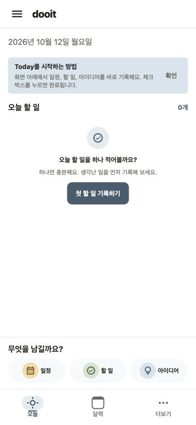
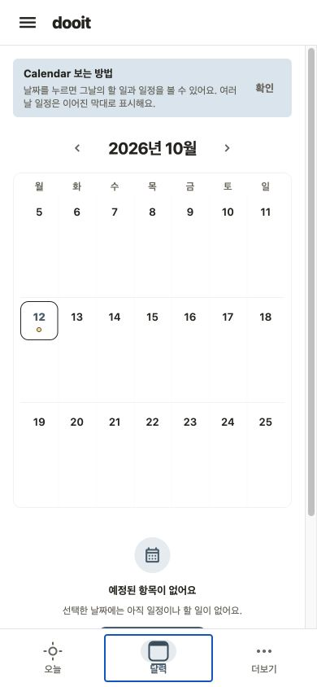
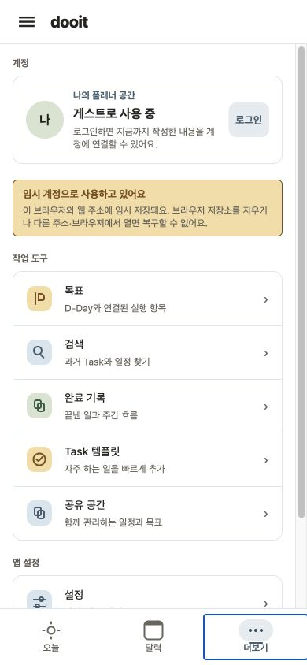
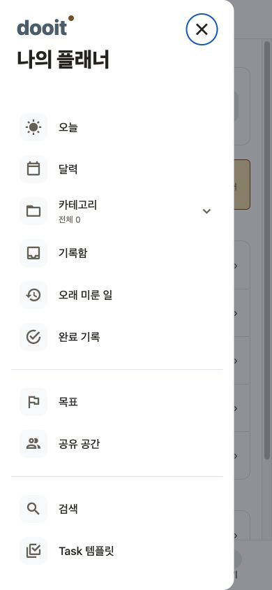
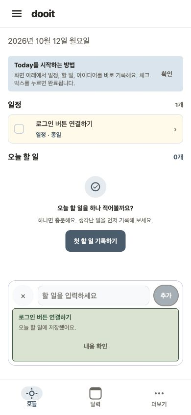
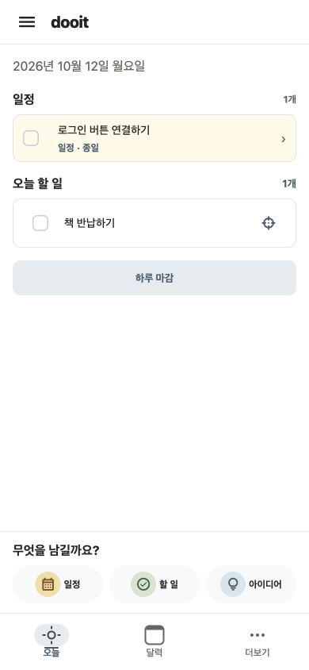
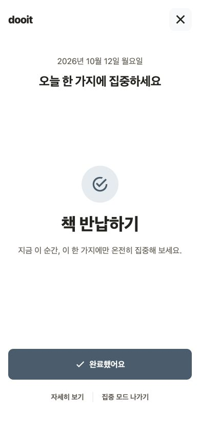

# Dooit 전반 UI·정보 구조 검토

검토일: 2026-10-12

## 결론과 상태

하단 탭의 형태와 함께 화면별 역할·작성 진입·목록 밀도를 정돈하는 것이 우선이다. 오늘은 실행, 달력은 날짜 탐색, 전체는 목적지 탐색으로 구분한다. 시스템 기능이 준비되면 돌아보기를 주요 목적지로 확장하는 것을 제안한다. UI 코드는 수정하지 않았다. 아래 제안은 사용자 선택 전이며 디자인 확정·구현 완료를 뜻하지 않는다.

후속 사용자 선택: 시스템 실행은 3번의 제안형 sheet로 결정됐다. 당시 오래된 Today 캡처에서 주간 strip을 가져온 것은 현재 코드와 불일치한다. 최신 Today는 날짜 한 줄을 표시하고 `TodayWeekStrip`을 렌더링하지 않는다. 이전 시각안의 주간 strip과 하단 탭을 이번 개선의 기준으로 사용하지 않는다.

2026-10-13 보충: 페이지 필요성까지 검토한 [전체 구조 제안](../../product/PRODUCT_ARCHITECTURE_REVIEW_2026-10-13.md)에서 오늘·계획·돌아보기를 우선 추천한다. 아래 오늘·달력·전체는 점진 전환안이며 최종 확정 구조가 아니다. 당시 캡처·관찰 내용은 유지한다.

## 환경과 검증 범위

- 대상: `main`, `6fd5293`, 기존 미커밋 문서는 유지. 제품 코드 변경 없음.
- 플랫폼: Expo Web, mock API, 새 게스트, Chrome 확장, 390×844, light, Asia/Seoul.
- 내장 브라우저 `iab` 연결이 unavailable로 실패했다. 기존 8092 주소는 ERR_EMPTY_RESPONSE였고 별도 mock 서버 8095를 실행해 같은 Chrome 검토 탭에서 복구했다. 기존 사용자의 로그인 탭은 사용하지 않았다. 로컬 Playwright는 사용하지 않았다.
- Chrome AX capture가 안정되지 않아 동일 탭의 DOM snapshot과 screenshot을 사용했다. click 전달 timeout 후 상태를 확인하고 키보드 Enter로 이동·작성했다. 키보드 focus ring은 접근성 표시이므로 미관 결함으로 분류하지 않는다.
- 날짜를 포함한 빠른 기록 하나와 날짜 없는 기록 하나를 mock에서 생성했다. 날짜 없는 기록은 오늘로 옮겼다. 실제 사용자/운영 데이터는 수정하지 않았다.
- 캡처 PNG는 이번 실행에서 직접 저장하고 확인했다. Viewport override는 검토 후 해제했다.
- 정상 탐색·기본 입력·mock 저장·오늘 이동·집중 진입·메뉴 닫힘 후 trigger focus 복귀를 확인했다. 완료 mutation·실기기 터치·가상 키보드·큰 글꼴·dark·VoiceOver/TalkBack·API 실패·대량 일정은 미검증이다.
- 캡처한 console에는 shadow style deprecation 경고가 있었다. 기능 오류의 증거로 확대하지 않는다. 성능·접근성 전체 통과 판정은 하지 않는다.

## 단계별 화면과 발견

### 1. Today 첫 사용 — 시작은 가능, 정보 위계 개선 필요

- 장점: 빈 상태에서 첫 기록으로 들어갈 수 있고 일정·할 일·아이디어를 구분한다.
- 중간 UX 문제: 상단 로고·날짜·안내, 중앙 빈 상태 CTA, 하단 작성 dock과 tab bar가 별도 층으로 쌓인다. 첫 사용 안내는 닫을 수 있으므로 영구 노출로 오해하지 않는다.
- 개선: 화면 제목 오늘과 짧은 날짜를 하나의 헤더로 합치고 작성은 대표 진입 하나로 정리한다. 초기 안내는 해당 행동 가까이에 작게 제공한다.
- 접근성 한계: 390px에서는 주요 CTA가 보인다. 동적 글꼴·스크린리더 읽기 순서·터치 영역은 추가 검증 필요.

### 2. 달력 — 이동 가능, 빈 공간이 선택일 내용을 밀어냄

- 장점: 날짜 버튼의 이름과 오늘 표시, 월 선택·주 이동이 있다.
- 중간 UX 문제: 일정 없는 3주 grid에서도 행 높이가 크고 선택일 목록/추가 행동은 첫 viewport 아래로 밀린다. 월 제목에 비해 3주 표시라는 범위가 분명하지 않다.
- 개선: 날짜 탐색은 이 화면에 모은다. 빈 주의 행 높이를 줄이고 월 단위 날짜 선택+선택일 목록 또는 compact 주간+일정 목록을 후속 시각안으로 비교한다. 여러 날 일정 bar·overflow 처리와 함께 검증해야 한다.
- 접근성: 캡처의 파란 outline은 키보드 focus라 유지 대상이다. 좁은 폭의 날짜 touch target·큰 글꼴·일정 많은 상태 미검증.

### 3. 더보기 — 목적지는 찾을 수 있으나 계정과 도구가 혼재

- 장점: 각 목적지에 짧은 설명을 제공한다.
- 중간 UX 문제: 계정 카드와 게스트 경고가 먼저 크고, 작업 도구와 설정은 아래로 밀린다. 전체 메뉴와 같은 목적지가 중복된다.
- 시각 문제: 완료 기록·Task 템플릿·공유 공간의 Web icon 의미가 서로 유사하거나 맞지 않는다. 코드에서 Web fallback 매핑도 확인했다.
- 개선: 전체로 역할을 명시하고 계정·설정은 하위 그룹으로 정돈한다. 게스트 데이터 보존 정보는 유지하되 반복 큰 카드 대신 명확한 상태 안내와 상세 진입으로 구성한다. 아이콘 계열·의미를 통일한다.
- 접근성 한계: 스크롤 아래 설정 발견 가능성·큰 글꼴 확인 필요.

### 4. 전체 메뉴 — 탐색 중복과 용어 정리 필요

- 장점: 목적지가 그룹화되어 있고 닫은 뒤 메뉴 trigger로 focus가 돌아온다.
- 중간 UX 문제: 오늘·달력 탭과 더보기 항목을 다시 나열한다. 사용자가 어느 탐색 체계를 기준으로 익혀야 하는지 불분명하다. 모바일 화면에 메뉴가 길다.
- 개선: 모바일에서는 전체 화면으로 목적지 탐색을 통합한다. 넓은 Web에서는 같은 목적지 구성을 sidebar로 표현할 수 있다. 한 번에 drawer를 삭제하기 전에 category·공유 공간·기록함·검색 경로와 deep link를 모두 보존한다.
- 문구: Task 템플릿→할 일 템플릿, 오래 미룬 일→다시 살펴볼 일 후보. 이름 변경이 실제 조회 의미를 바꾸지 않도록 설명을 제공한다.
- 접근성 한계: 전체 focus trap·배경 스크린리더 차단은 미검증이다.

### 5. 빠른 기록 — 저장 유형과 안내 불일치, 우선 수정

- 재현: Today의 할 일 추가에서 `오늘 로그인 버튼 연결하기` 입력 후 저장.
- 높음 UX 문제: 화면에는 일정·종일로 나타나지만 결과 안내는 오늘 할 일에 저장했다고 말한다. 오늘 할 일은 0개와 빈 상태를 유지한다.
- 코드 근거: mock parser는 날짜 등 파싱 성공 시 SCHEDULE을 생성한다. real backend도 동일한지는 이번에 확인하지 않았다.
- 개선: 사용자 선택 유형과 자연어 날짜의 관계를 합의하고, 최소한 저장 결과는 실제 유형·위치에 맞춰 안내한다. 날짜만 입력했다고 할 일을 일정으로 바꾸지 않는 방향을 제안한다. 예상 계약 변경이 필요하면 별도 백엔드 추가 요청으로 관리한다.
- 검증: 오늘/내일+할 일, 명시적 시각 일정, 날짜 없는 아이디어, 저장 실패·재시도와 real API를 포함한다.

### 6. 일상 Today — 목록은 명료, 아래 작성 영역의 존재감이 큼

- 장점: 일정·할 일이 구분되고 상세·완료·집중 행동이 분리되어 있다. 온보딩 안내는 확인 후 사라진다.
- 중간 UX 문제: 하단 작성 dock 약 104px와 tab bar 약 72px가 연속되어 844px 화면의 약 21%를 차지한다. 여기에 body에는 144px 하단 padding이 설정되어 있어 다양한 내용 길이에서 간격을 검증해야 한다.
- 중간 시각 문제: tab bar는 선택 배경·밑줄·아이콘 색·label 굵기를 겹쳐 사용한다. Web에서 태양·달력은 직접 만든 도형이다. 행 오른쪽 조준점 형태의 집중 아이콘은 처음 보는 사람이 기능을 추측하기 어렵다.
- 개선: 대표 추가 버튼 하나에서 빠른 입력과 유형 변경을 제공하고, 탭은 통일된 icon family·작은 label·단순 선택 상태를 사용한다. 집중은 필요한 행에 시작이라는 명확한 행동으로 표현한다.
- 접근성: 아이콘을 작게 하더라도 터치 영역 44pt 이상을 유지하고 focus ring을 제거하지 않는다.

### 7. 한 가지 실행 — 단순하지만 시스템 실행 문맥 부족

- 장점: 제목과 완료 행동이 분명하고 진입이 가능하다.
- 중간 UX 문제: 날짜·집중하라는 문구·장식 아이콘·넓은 공백이 핵심 행동보다 큰 비중을 가진다. 일반 Task에는 반복 실행의 시작 조건·최소 행동·다음 행동 정보가 없다.
- 개선: 시스템 연결 항목에서는 다음 행동을 먼저, 최소 행동과 쉬기를 보조로 제공한다. 일반 Task는 간단한 완료 흐름을 유지한다. 상단/하단 나가기 중복은 접근 편의와 밀도를 비교해 정한다.
- 접근성 한계: 종료·완료 뒤 focus·feedback과 native 큰 글꼴 미검증.

## 수정 우선순위

| ID    | 우선순위       | 변경                                    | 기능/디자인 수용 기준                                                                                  |
| ----- | -------------- | --------------------------------------- | ------------------------------------------------------------------------------------------------------ |
| UI-01 | P1             | 하단 tab icon·label·선택 상태·높이 정돈 | 390px에서 일관된 22~24px icon과 12px 내외 label, 44pt 이상 hit target, safe area 보존, 선택·focus 구분 |
| UI-02 | P1             | 작성 dock을 대표 추가 진입으로 축소     | 한 번 탭해 할 일 입력, 유형 선택 가능, 목록 마지막 행·키보드 CTA 가림 없음                             |
| UI-03 | P1             | 오늘 header와 목적 정리                 | 오늘+짧은 날짜, 주간 strip 없음, 다음 행동이 첫 화면에서 명확                                          |
| UI-04 | P1             | 더보기/메뉴 통합 정보 구조              | 기존 모든 목적지·category·Workspace·계정 경로 유지, mobile 중복 탐색 감소                              |
| UI-05 | P1             | 달력 밀도·범위 정리                     | 빈 날에도 선택일 내용 접근이 빠름, 다일 일정·많은 일정에서 clipping 없음                               |
| UI-06 | P1             | 빠른 기록 유형·결과 안내 정합성         | 선택한 유형·저장된 유형·목적지·안내가 일치; mock/real 모두 확인                                        |
| UI-07 | P2             | 공통 icon·spacing·목록·색 규칙 정돈     | Web/native 의미 일치, 모든 행을 카드화하지 않음, 완료·일정 구분 유지                                   |
| UI-08 | P2             | 용어·온보딩·게스트 안내 정돈            | 사용자 표기에 Today/Calendar/Task 혼용 제거, 필요한 데이터 보존 안내 유지                              |
| UI-09 | 신규 기능 단계 | 시스템 실행·돌아보기·짧은 응원 결합     | 기존 실행을 밀지 않고 기록 근거만 제시, 휴식 존중, 문구 숨기기 가능                                    |

P1/P2는 이번 UI 개선 안의 순서이며 기존 출시 P0를 덮어쓰지 않는다. 높음 UX 문제는 UI-06이며 단순 미관 수정으로 보류하지 않는다.

## 제안하는 화면 역할과 이름

- 오늘: 오늘 예정된 일정·할 일·시스템의 다음 행동. 짧은 응원은 선택적으로 한 곳에만 둔다. 날짜 없는 기록 전체나 큰 주간 통계는 펼치지 않는다.
- 달력: 다른 날짜·향후 계획을 탐색. Today에 주간 달력을 다시 추가하지 않는다.
- 돌아보기: 완료 기록·시스템 실천 증거·주간 회고. 기능이 준비될 때 주요 탭으로 승격한다.
- 전체: 내 시스템·보관함(현재 기록함 명칭 변경 후보)·목표·공유 공간·검색·템플릿·계정/설정. 시스템은 오늘에서 실행하고 전체에서 관리한다.

단기안은 오늘·달력·전체 3개, 시스템 회고가 준비된 목표안은 오늘·달력·돌아보기·전체 4개를 추천한다. 빈 돌아보기 탭을 먼저 만들지 않는다. 내 시스템의 관리 빈도가 높다는 실제 근거가 생기면 탭 승격을 재검토한다.

오늘은 실행 목적이 명확해 유지 추천. 홈은 범위가 모호하고, 시작/실천은 일반 일정·일회성 할 일을 충분히 설명하지 못한다. 오늘에 목표·통계·명언 피드를 모두 쌓는 방향을 피한다. 상단 화면 제목도 오늘로 맞추고 브랜드 로고는 진입·전체 화면에서 사용한다.

## 하단 탭 제안 수치 — 시각 선택 전 후보

- 같은 icon family와 광학 크기 22~24px 사용. 현재 설치된 vector icon으로 먼저 검토한다.
- label은 항상 표시, 12px 내외. 선택은 진한 foreground+semibold로 표현하고 현재의 작은 밑줄과 배경 pill을 동시에 쓰지 않는다.
- 흰 surface와 얇은 상단 구분선. 기본 높이는 60~64px+safe area 후보이며 큰 글꼴에서는 높이를 늘린다. 44pt touch target은 유지한다.
- 추가 버튼은 destination tab으로 섞지 않고 별도 작성 행동으로 제공한다. 키보드와 native home indicator에 겹치지 않도록 검증한다.
- 반투명 glass·큰 floating capsule 등은 기능적 이점이 확인되지 않아 기본안으로 채택하지 않는다.

## 비교 서비스에서 가져올 원칙

아래는 공식 문서 기반 참고이며 경쟁 앱의 현행 UI를 직접 조작한 감사가 아니다. 색상·외형 복제를 제안하지 않는다.

- [Things: Today/Upcoming/Anytime/Someday](https://culturedcode.com/things/support/articles/4001304/): 오늘 할 일과 향후 계획·아직 계획 없는 바람을 분리하는 구조. Dooit은 오늘 실행과 날짜 탐색·바람 보관의 역할을 나눈다.
- [Todoist: Today](https://www.todoist.com/help/todoist/get-started/plan-your-day-with-the-today-view-UVUXaiSs): 프로젝트가 달라도 오늘 예정된 일을 모아 보는 역할. Dooit도 첫 화면의 기준을 오늘 실행으로 명시한다.
- [Apple: Tab bars](https://developer.apple.com/design/human-interface-guidelines/tab-bars): 주요 목적지와 label의 명확성을 참고한다. 웹 검색에서 안내 내용을 확인했으나 페이지 본문 추출은 제한적이었다. 위 구체 치수는 Dooit의 제안이며 Apple의 필수 규격 인용이 아니다.

## 다음 작업과 범위

1. 위 역할 분리와 명칭을 반영한 새 Today/하단 탐색 시각안 3개를 비교한다. 기존 3개 이미지는 구조 참고만 유지한다.
2. 선택 후 UI-01~03을 완결된 변경으로 구현·감사한다. UI-06은 별도 기능 정합성 변경으로 처리한다.
3. UI-04~05를 기존 경로 보존 검증과 함께 진행하고 시스템·돌아보기 기능에 연결한다.
4. 320·390·430px, font scale 1.5, dark, 키보드, safe area, VoiceOver/TalkBack, Web focus·Escape를 단계별로 검증한다.

이번 작업은 검토·문서화이며 화면 리디자인 구현은 포함하지 않는다. 검증 커맨드 결과는 작업 완료 시 함께 보고한다.
