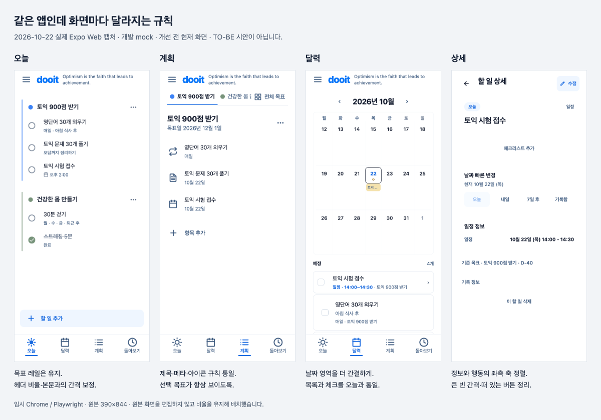

# 전체 디자인 완성도 — 실제 Web 재감사

2026-10-22 · HEAD `479ae87` + 기존 미커밋 변경 · 이번 회차 앱 소스 수정 없음

## 판정

**개선 필요.** 목표별 레일과 네 탭의 방향은 유지할 수 있다. 헤더·본문의 정렬, 페이지마다 다른 글자/아이콘/행/버튼, 긴 작성 흐름과 달력의 공간 배분을 개선해야 한다. 이전 시안 정합성 `passed`는 국소 비교 결과이며 이 전체 완성도 판정과 구분한다. [수정 기준과 실행 순서](../../design/VISUAL_COHESION_REVIEW_2026-10-22.md)를 다음 디자인 작업의 기준으로 사용한다.

[비교 보드 HTML](./overview.html)은 이번 실제 화면을 비율 유지해 배치한 보고서다. TO-BE 생성 시안이 아니다. 원본 23장과 비교 보드 1장을 구분한다.

## 환경과 도구

- Product Design index/audit 및 해당 검토 기준. 추가 프론트엔드 원문 자료의 적용 범위는 위 설계 문서에 기록했다.
- IAB와 Chrome 확장 inventory가 비어 있고 `Browser is not available`, native는 `Sky Computer Use native pipe startup failed`. 도구 초기화와 직접 IAB/Chrome 생성·Chrome 앱 연결도 실패했다. localhost 8081/8082 서버는 실행 중이었다.
- 사용자가 **‘로컬 Playwright로 계속 진행’**을 명시 승인했다. 샌드박스 안 Chrome 실행 실패 후 권한을 받아 임시 headless Chrome을 실행했다. 기존 사용자 profile/session을 재사용하지 않았다.
- Playwright 1.55.0 / Chrome 155.0.8059.85 / Expo Web / light / deviceScaleFactor 1 / ko-KR / Asia/Seoul.
- localhost:8082, mock, opt-in `goal-lanes` 개발 fixture. 처음에는 새 게스트 빈 화면, 이후 mock demo 계정으로 같은 시안 내용의 기존 D-Day/Task를 확인했다. 새 Goal 하나는 UI에서 생성했다. 운영 API·실제 사용자 데이터는 사용하지 않았다.
- 기본 390×844. 오늘 320×844와 1024×844 추가 확인. 캡처 원본은 이 폴더, 실행 메타데이터는 [run.json](./run.json).
- 아래 PNG는 모두 **이번 run에서 실제 앱을 새로 캡처**하고 직접 열어 확인했다. 생성 시안이나 과거 캡처가 아니다. Drawer 첫 캡처는 전환 중 반투명 상태여서 버리고 전환 완료 후 재촬영했다.

## 화면별 근거

### 1. 오늘 — 구조 유지, 헤더와 정렬 보정 필요

[게스트 빈 화면](./01-today-empty-390.png), [계정 연결 직후](./05-today-populated.png), [일반 진입](./06-today-resting.png), [320px](./22-today-320.png), [1024px](./23-today-wide.png).

목표별 레일·체크·완료 취소 상태와 단일 추가 진입은 읽기 쉽다. 작은 영문 문구가 두 줄로 바뀌며 헤더가 빽빽해지고, 본문 시작까지 32px 여백이 있어 한 덩어리로 연결되는 느낌이 약하다. 넓은 Web에서는 본문은 가운데, 헤더는 왼쪽 끝에 남는다. 두 폭에서 가로 overflow는 없었다.

계정 연결 성공 안내는 `accountLinked` 문맥이 있는 진입에서 나타났고 일반 `/` 진입에서는 사라졌다. 이를 일반 오늘 화면의 상시 영역으로 판단하지 않는다. 원형 체크와 작은 glyph의 시각 크기, 44 이상 조작 영역을 구분해 보정한다.

### 2. Drawer — 위치 유지, 브랜드/아이콘과 중복 목적지 정리

[메뉴](./02-drawer.png). 검색·기록 정리·도구·계정 그룹은 구분된다. 메인 헤더와 Drawer의 dooit 크기, 닫기/메뉴/목록 아이콘의 시각 무게가 다르다. ‘날짜별 완료 기록’과 돌아보기의 관계를 정리할 필요가 있다. 작은 메뉴 그림과 실제 터치 영역을 함께 확인해야 한다. 내부 모든 목적지와 보조 기술 focus trap을 이번 run에서 검사한 것은 아니다.

### 3. 계정·로그인 — 보관 안내와 브랜드 일관성 개선

[게스트 계정](./03-account-guest.png), [로그인](./04-login.png). 게스트 유지와 로그인 선택은 보존한다. 계정은 비슷한 설명과 강한 노란 경고 박스가 반복되고, 로그인은 D 배지·Dooit·큰 제목·폼 바깥 박스를 사용해 메인 dooit/목록과 시각 언어가 달라진다. mock 로그인 진입/복귀는 확인했으며 실제 인증·오류·병합 안전성을 검증한 것은 아니다.

### 4. 오늘 작성 — 기본 행동에 불필요한 선택 단계

[추가 메뉴](./07-today-add-menu.png), [할 일 입력](./08-today-quick-create.png). ‘할 일 추가 → 할 일 → 입력’으로 같은 종류를 두 번 선택한다. 기본 입력을 바로 열고 일정/목표/날짜는 같은 흐름에서 선택하는 안을 비교한다. 메뉴의 아이콘, 닫기 문자 ×, 작은 원형 추가 버튼은 공통 행동 스타일과 맞춰야 한다. 입력 진입/닫기를 확인했으며 이번 run에서 이 경로의 신규 Task 저장은 하지 않았다.

### 5. 상세·편집 — 정보 축과 행동 위계 개선

[일정 상세](./09-task-detail.png), [일정 편집](./10-task-edit.png). 실제 날짜·시간과 기존 목표 연결을 보여주지만 체크리스트 추가·날짜 빠른 변경·일정 정보·목표·기록·삭제가 여러 축과 큰 간격에 흩어져 있다. 공통 20px 축과 compact 정보 행을 기준으로 정렬한다. 편집의 제목/유형/날짜/시간은 식별 가능하다. 직접 날짜 문자열, 부가 설정, 취소/저장 위치를 다른 폼과 통일할 필요가 있다. 상세→편집→취소→오늘 복귀를 확인했다.

### 6. 계획·전체 목표 — 관리 역할 유지, 선택 맥락 복구

[기존 목표](./11-plan.png), [전체 목표 펼침](./15-goal-switcher.png), [새 목표 폼](./16-goal-create.png), [생성 후 선택](./17-new-goal.png). 전체 목표를 펼치면 목록과 선택 목표의 본문이 함께 길게 늘어난다. 새 목표 생성 후 제목은 바뀌었지만 선택된 새 목표 탭은 보이는 가로 영역 밖에 남았다. 선택 tab의 `aria-selected`도 snapshot에서 확인되지 않았다. 자동 스크롤·선택 상태를 우선 고치고 전체 선택기의 별도 화면/sheet 여부는 시안 비교로 정한다.

새 Goal 생성은 mock UI로 수행했다. 기존 D-Day 아래는 일회성/반복/일정 목록이 있지만 새 Goal 아래는 ‘반복 계획 추가’만 있다. 이를 동일한 기능 범위로 표현하지 않는다.

### 7. 반복 계획 — 입력 중복과 오류 복귀 우선 개선

[폼 위](./18-repeat-create-top.png), [폼 아래](./19-repeat-create-bottom.png), [빈 저장 오류](./20-repeat-error.png). 목표 탭·목표 제목·폼 제목 뒤에 입력이 이어져 기본/최소 행동까지 긴 스크롤이 필요하다. ‘반복할 일’과 ‘평소에는’ 중복, 상시 `Asia/Seoul` 설명은 입력 부담을 높인다. 저장을 눌렀을 때 하단 alert는 나오지만 첫 잘못된 이름 입력으로 이동하지 않고 초점이 저장 버튼에 남는다. 요일 버튼은 snapshot에 선택 상태를 노출하지 않았다.

필수 행동/반복/작은 버전을 먼저 배치하고 날짜 상세·분량은 필요할 때 펼친다. 오류가 난 필드로 이동하면서 입력값을 보존한다. 빈 입력 오류와 취소만 확인했고 반복 저장·실행 완료를 확인한 것은 아니다.

### 8. 달력 — 이동 단위와 공간 배분 개선

[첫 안내 포함](./12-calendar.png), [안내 닫은 후](./13-calendar-resting.png). 별도 탭 진입은 적절하다. 3주 그리드가 약 414px를 차지해 선택일 내용이 아래로 밀리고, 월 제목 옆 화살표의 accessible name은 이전/다음 ‘주’라 이동 단위가 시각적으로 불분명하다. 오늘과 다른 사각 체크·카드형 목록을 사용한다. 압축된 날짜 탐색과 공통 Task 행을 검토한다. 월/주 구조 변경은 3안 비교 대상이다. 안내 닫기와 현재 날짜 목록만 확인했으며 월 경계/연속 일정 전체 동작은 이번 run 범위 밖이다.

### 9. 돌아보기 — 실제 기록 유지, 주간 맥락과 통합 범위 개선

[주간 기록](./14-review.png). 실제 완료 제목과 날짜만 보여주는 방향은 좋다. 주 범위와 비활성 ‘이번 주’가 작은 한 줄에 모이고, 목표 제목·건수·기록의 정렬/크기가 오늘과 다르다. 주간 탐색/복귀의 위계를 보정한다. 단순히 비어 보인다는 이유로 차트나 격려 카드를 추가하지 않는다. 기존 Task 1개 기록을 확인했으며 새 Goal 통합 여정은 미연결이다.

### 10. 설정 — 공통 스타일 확장 필요

[설정](./21-settings.png). 동기부여 문구의 기본/덜 보기/숨기기 설정을 발견할 수 있다. 큰 테두리 카드·아이콘 배경·긴 설명이 Today의 간결한 목록과 다른 밀도를 만든다. 기능별 설정 행으로 정리하고 출처 확인은 유지한다. 맨 위 개발자 진단은 development 전용이므로 운영 사용자가 보는 불필요 UI라고 판단하지 않는다. 저장 설정 변경/알림 권한은 이번에 조작하지 않았다.

## 실행 항목

| ID    | 우선순위 | 근거           | 수정 방향                                                         |
| ----- | -------- | -------------- | ----------------------------------------------------------------- |
| VC-01 | P1       | 1, 2, 3, 9     | 공통 헤더/brand의 크기·간격·문구 길이·최대 폭, 본문과 정렬        |
| VC-02 | P1       | 1, 5, 6, 8, 10 | 글자/색/아이콘/행/버튼 공통 규칙. 화면별 임의 크기·박스 축소      |
| VC-03 | P1       | 6              | 생성/선택 목표 탭이 보이도록 이동하고 선택 상태를 노출            |
| VC-04 | P1       | 7              | 첫 오류 필드로 스크롤/초점, 요일 선택 의미 제공. UX-06·08과 연결  |
| VC-05 | P1       | 4, 6, 7        | 기본 작성 진입 단축, 필수/선택 입력, 목표/날짜 문맥. UX-03과 연결 |
| VC-06 | P1       | 5              | 상세의 정보/행동 축 정렬. UX-05 첫 보정 이후 남은 완성도          |
| VC-07 | P1       | 8              | 달력 밀도와 주/월 이동 의미. UX-04 후속                           |
| VC-08 | P2       | 2, 3, 9, 10    | 기록 목적지 중복·돌아보기 탐색·계정/인증/설정 공통 표현           |

P1/P2는 이번 디자인 작업의 순서이며 기능 출시 위험도 전체를 대체하지 않는다. 실제 실행 연결 UX-01·02·07과 G-07 등 API 경계는 [로드맵](../../product/ROADMAP.md)에 유지한다.

## 검증 경계

- 현재 run의 pageerror 0. 모든 console warning·네트워크 실패가 0이라는 뜻은 아니다.
- 320px/1024px 오늘의 document width와 scrollWidth가 각각 동일했다. 전체 화면·글자 확대에서 잘림이 없다는 판정은 아니다.
- 새 Goal 생성, 빈 반복 저장 오류, 취소, 주요 탭·상세·편집·메뉴·mock 로그인 이동을 확인했다. 핵심 mutation/오류 전체 수용 검사와 구분한다.
- VoiceOver/TalkBack·키보드 전체 탐색·font scale 1.5·dark·Android/iOS safe area/키보드·실제 API/알림은 미확인이다. 화면만으로 접근성 준수를 선언하지 않는다.
- 검색·기록함·템플릿·공유 공간 내부는 이번 run에서 새로 캡처하지 않았다. 이번 기록을 앱의 모든 흐름이 통과했다는 의미로 사용하지 않는다.
- 이번 회차 앱 코드는 변경하지 않았다. 문서/캡처 추가 후 `npm run validate` 통과: typecheck·lint·format·문서 링크/캡처 유효기간·정적 release 검사와 113 suites / 589 tests, STG 1개 제외. `git diff --check`도 통과했다. 자동 검사 통과가 위 시각 문제의 해결을 뜻하지 않는다.
