# Whole-app audit screenshots

2026-10-21 / ddde85b / Expo Web / mock / Chrome / 390x844 (28, 30, 31: 320x844).

[Audit report](./README.md)

Captured in this audit session and inspected after saving. Development indicators are excluded from product judgments.

## 01 plan

## 02 plan editor

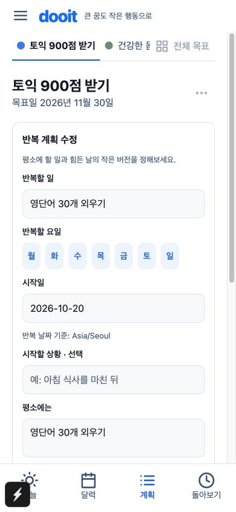

## 03 today empty with due plan

## 04 add menu

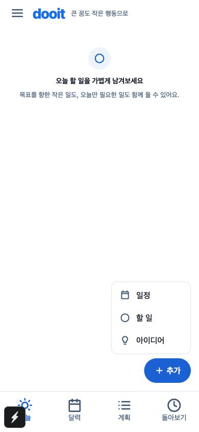

## 05 quick capture

## 06 capture inbox result

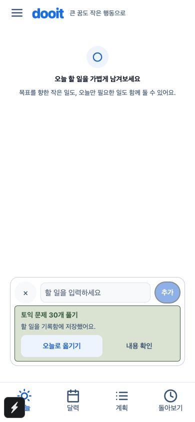

## 07 today task

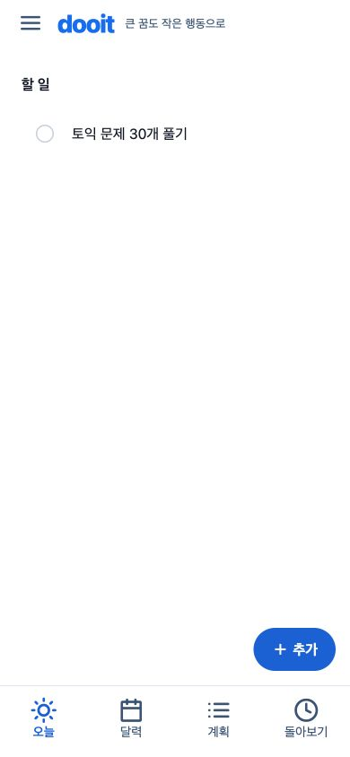

## 08 calendar first viewport

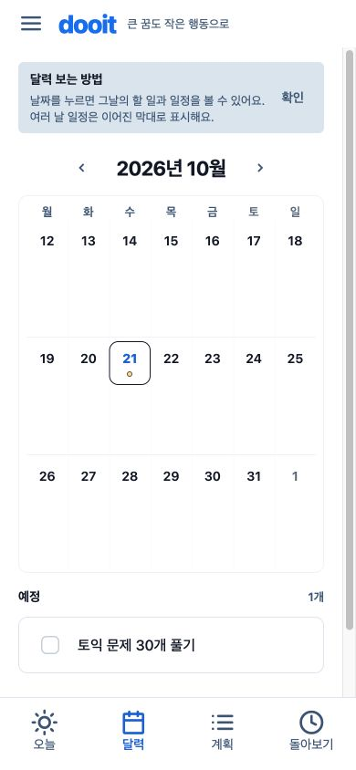

## 09 calendar tip dismissed

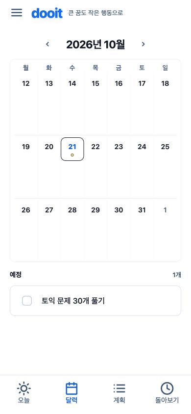

## 10 task detail

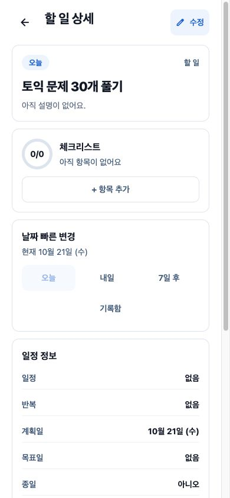

## 11 task goal link

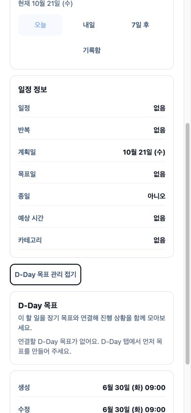

## 12 task edit

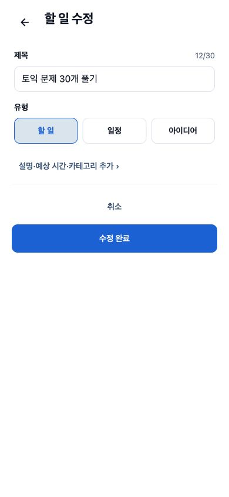

## 13 schedule form

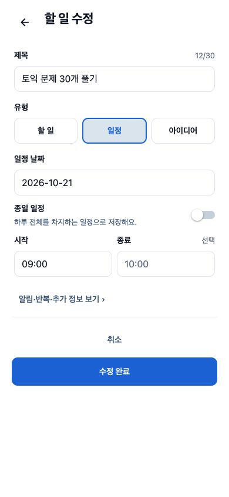

## 14 after completion

## 15 review with record

## 16 goal switcher

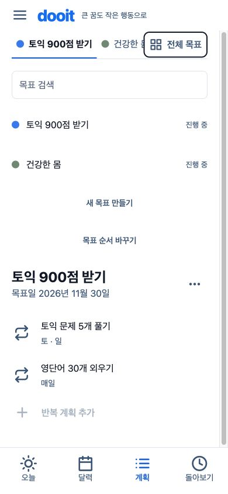

## 17 drawer

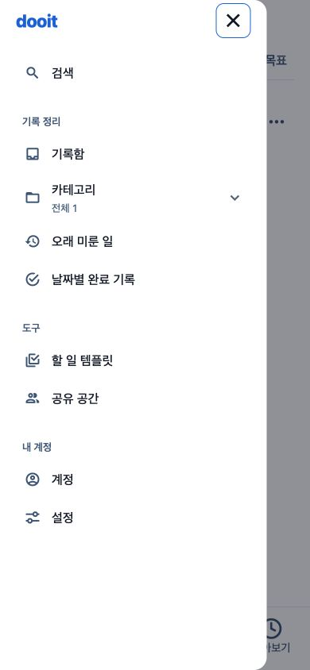

## 18 search task

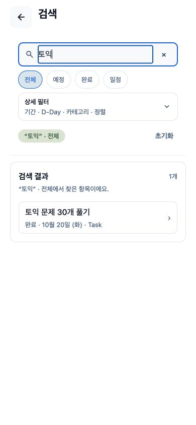

## 19 search goal scope

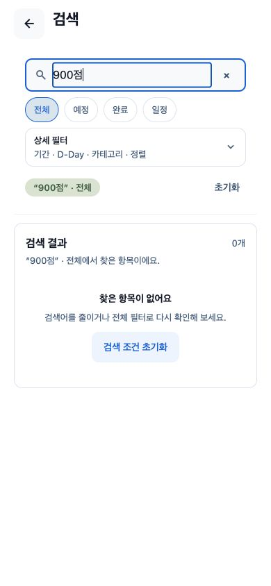

## 20 inbox

## 21 account

## 22 settings

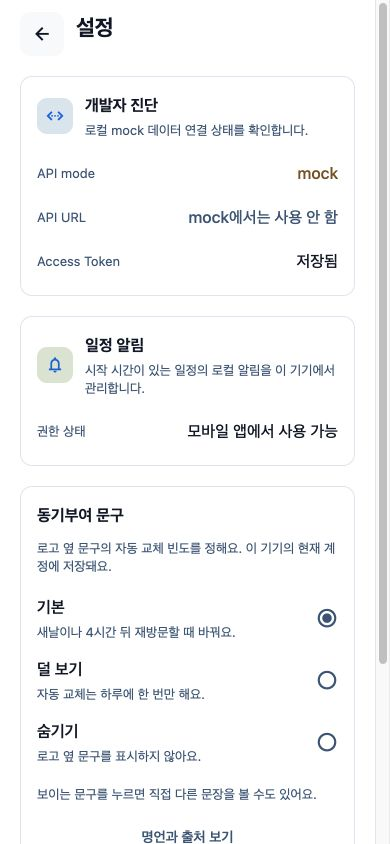

## 23 templates

## 24 workspaces

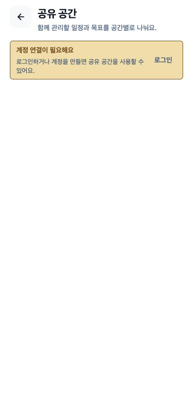

## 25 login

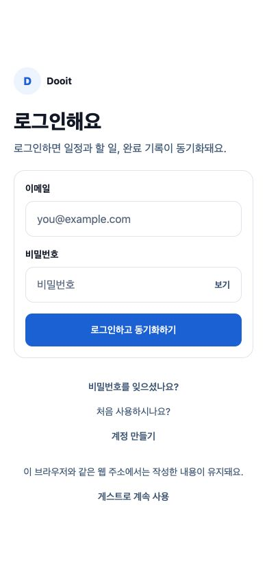

## 26 register

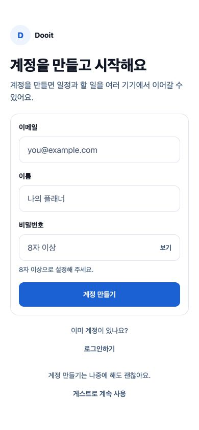

## 27 password reset

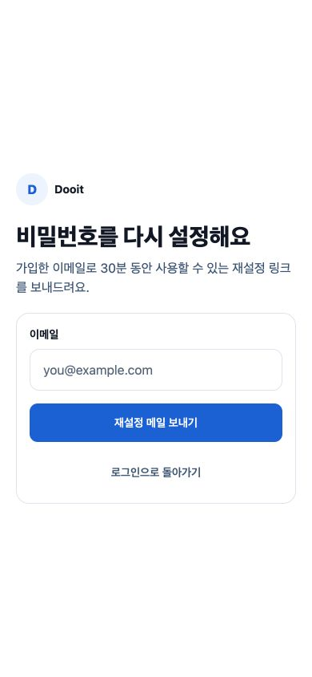

## 28 register 320

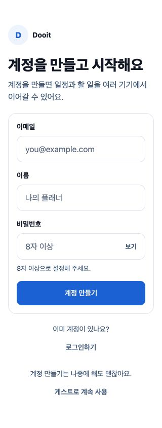

## 29 plan validation

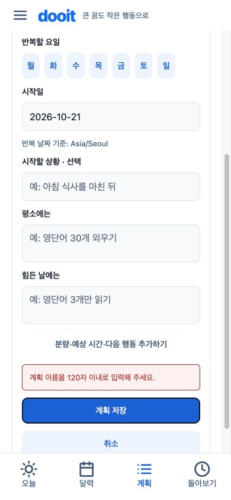

## 30 plan 320

## 31 menu keyboard state

## 32 new goal

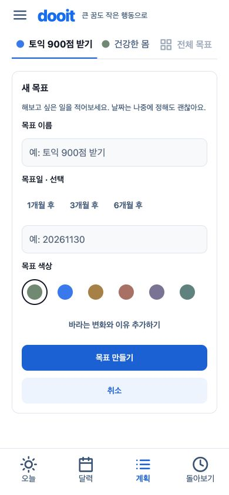

## 33 goal direction

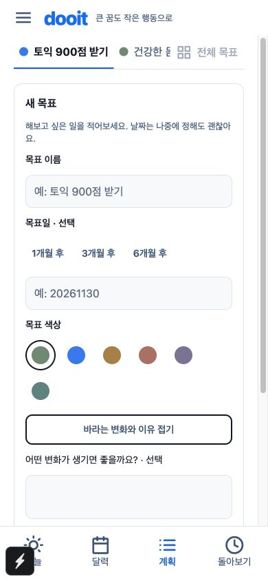
