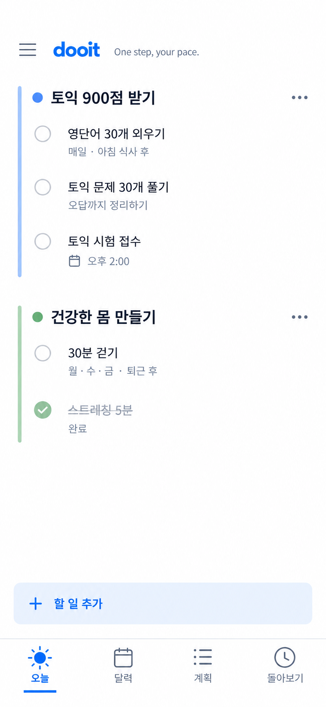

# 첨부 시안을 기준으로 한 목표별 색상 레일 보정

2026-10-21 · 기준 커밋 `479ae87` 이후 working tree · 미커밋

## 원본과 판단 정정

**최신 기준은 사용자가 직접 첨부한 아래 이미지다.** 이전에 ‘3번’을 회색 바탕·흰 카드 이미지로 연결한 것은 구현 측의 참조 오류였다. 사용자 방향 변경으로 기록하지 않는다. 번호 대신 원본 파일을 기준으로 비교한다.

원본: `exec-d5f8134e-c2f6-4cfc-bef8-171d8d33041f.png`, 853×1844. 생성 시안이며 실제 앱 캡처가 아니다. [이전 카드형 문서](../soft-goal-surfaces-2026-10-21/README.md)는 당시 작업 이력과 외부 자료 기록으로만 남긴다.

## 유지 / 변경 / 이유

사용자 목적은 목표 아래 오늘 해야 할 반복·일회성 일·일정을 바로 읽고 체크하는 것이다. 오늘·달력·계획·돌아보기의 역할과 순서, 왼쪽 메뉴, 작은 헤더 문구를 유지한다. 큰 ‘오늘’ 제목·날짜·주간 달력·달성률·노력 점수는 추가하지 않는다.

| 요소        | 구현 기준                                                               | 이유                                                                  |
| ----------- | ----------------------------------------------------------------------- | --------------------------------------------------------------------- |
| 바탕과 목표 | 흰 바탕, 카드 없이 4px 색상 레일·13px 원형 마커                         | 목표별 관계를 보여주되 상자와 가로 줄을 늘리지 않음                   |
| 글자        | 목표 18/26 semibold, 항목 16/24 regular, 메타 13/18                     | 목표와 할 일 위계를 유지하고 보조 정보는 아래에 둠                    |
| 간격과 조작 | 바깥 20, compact 16, 레일 안쪽 16, 목표 간 32, 행 최소 64, 조작 44 이상 | 긴 제목과 작은 화면에서도 체크와 상세 진입을 분리                     |
| 완료        | 같은 목표 아래에 실제 완료 기록, 취소선·체크·‘완료’                     | 완료 항목이 사라져 처음의 빈 안내로 돌아가지 않음                     |
| 추가        | 폭 전체의 옅은 파랑 버튼, 높이 최소 50, ‘할 일 추가’                    | 시안의 한 가지 작성 진입을 유지. 펼치면 기존 일정/할 일/아이디어 선택 |
| 하단 탐색   | 80 + native inset, 아이콘 28, label 14/20, 선택 밑줄 36×3               | 배경 pill 제거, 현재 위치와 조작 의미 보존                            |
| 헤더        | 기존 52 + native safe area, 작은 문구와 wordmark                        | 사용자 요청대로 생성 이미지의 큰 상단 공백은 복제하지 않음            |

공통 grouped surface는 흰 바탕·테두리/모서리 장식 없음으로 정정했다. 계획·개인 상세의 빈 정보 축소, 체크리스트 추가 진입, 기록 펼침, 날짜 표시 개선은 유지한다. Workspace의 기본 카드/체크리스트 variant는 일괄 변경하지 않았다.

원본의 정확한 폰트 파일과 icon set은 확인할 수 없어 기존 플랫폼 sans-serif, Feather/MaterialCommunityIcons/Ionicons와 iOS SF Symbols를 사용했다. 글자 획·아이콘 모양은 완전 일치가 아니다. 기존 목표 색상과 사용자 저장값을 존중하며 sage가 원본보다 차분하고, 미완료 체크 테두리는 원본보다 대비가 강하다. 목표색 저장 계약 변경은 없다. 새 의존성·raster asset 생성도 없다.

## 완료 기록의 동작과 경계

Today/Done 응답을 Task ID로 중복 제거하며 현재 Today 응답을 우선한다. 완료 항목은 해당 목표의 미완료 목록 뒤에 둔다. 일정도 기존 완료 API로 체크할 수 있다. 취소는 기존 reopen API를 쓰며 Task 상세 캐시도 갱신한다. 취소 뒤 위치는 반환된 todayOrder를 따르므로 원래 위치 복원까지 구현했다고 표현하지 않는다.

**현재 목표 묶음은 기존 D-Day 연결 Task다.** 새 Goal Plan 회차 hook은 아직 Today에 연결하지 않았다. 다음의 예시 화면이 새 Goal/Occurrence/여정 전체 연동 완료를 의미하지 않는다. 목표 메뉴의 ‘계획으로 이동’도 현재 일반 계획 진입이며 특정 목표 자동 선택은 후속이다. 빠른 작성의 기본 기록함 저장·오늘 이동 UX, G-07 전체 연결 항목 목록, 실제 주간 여정도 기존 로드맵에 남긴다.

## 재현 가능한 개발용 비교

`EXPO_OFFLINE=1 npm run web:design -- --localhost --port 8082`

`web:design`은 mock 모드와 `EXPO_PUBLIC_DESIGN_FIXTURE=goal-lanes`를 지정한다. mock client의 `__DEV__` 조건에서만 예시를 적용하며 기본 mock seed와 운영 API에는 적용하지 않는다. 독립 localhost:8082에서 예시 목표 두 개와 Task 다섯 개를 렌더링했다. 완료 상태도 mock API가 반환하는 실제 상태로 체크/취소하며 브라우저 evaluate로 기록을 주입하지 않았다. 리로드하면 이 예시의 초기 상태가 다시 구성된다.

## 사용한 검토와 검증 범위

Product Design image-to-code·audit·design QA 기준으로 원본과 실제 캡처를 직접 비교했다. 이전에 읽은 [추가 프론트엔드 자료](../soft-goal-surfaces-2026-10-21/README.md)의 위계·native 조작·Web 접근성 검토를 재사용했다. 이번에는 새로운 Figma 파일·외부 디자인 자료를 열었다거나 별도 전문가 승인을 받았다고 표현하지 않는다.

내장 브라우저가 앞선 작업에서 제공되지 않아 연결된 Chrome 확장 상태를 이어 썼다. 390×844 동일 내용 비교, 320/430px, 완료/취소·추가 메뉴/작성·목표 메뉴·키보드 탭 초점을 확인했다. 320px ‘돌아보기’ 잘림을 발견해 탭 좌우 여백을 수정했다. Android/iOS/Web 공통 영향이지만 실제 native safe area·글자 배율 1.5·dark·보조 기술·운영 API와 네트워크 오류는 미검증이다.

`npm run validate`: 113 suites / 589 tests 통과, STG 1개 제외. [실제 캡처·비교 이력과 제한](../../audits/goal-lanes-correction-2026-10-21/README.md).
