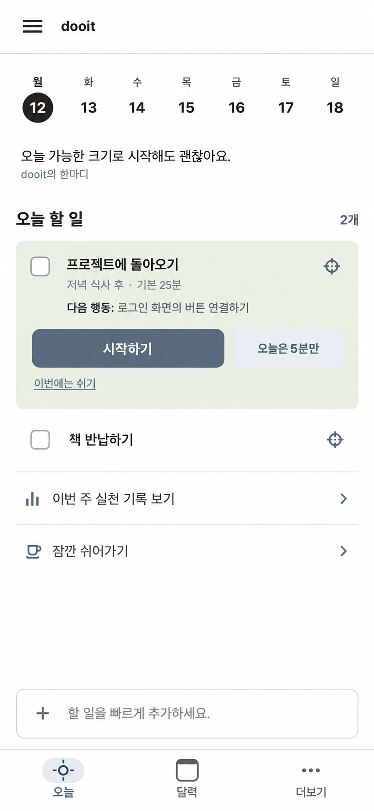
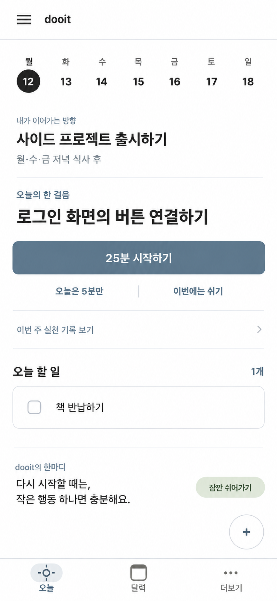
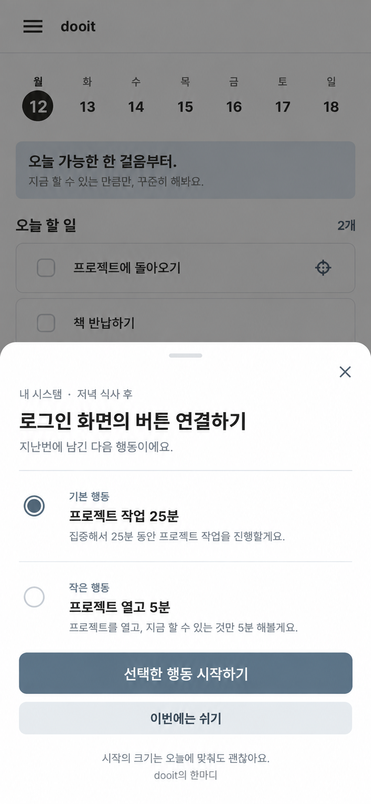

# 개인 시스템 Today 시각안 비교

Last updated: 2026-10-12

## 상태와 근거

FE-01/S2 진행 중. 2026-10-12 사용자가 표시 순서 3번을 선택했다. 선택 이유는 간결함과 사용자에게 행동을 제안하는 느낌이다. 목록에서 필요한 순간 실행 sheet를 여는 상호작용을 기준으로 삼는다. 전반 정보 구조·시각 검토는 별도로 진행 중이다. 번호는 대화에서 생성 이미지가 표시된 순서다. 아직 시스템 생성·주간 회고 화면 검토까지 완료한 것은 아니며 화면 코드 구현은 시작하지 않았다.

기준 커밋: `6fd5293`. 기존 [Today 캡처](../../screenshots/today.png), [디자인 규칙](../DESIGN.md), `src/theme/tokens.ts`와 [제품 제안](../../product/PERSONAL_SYSTEM_EXPERIENCE.md)을 참조했다. 기존 캡처는 2026-09-13 mock Web 자료로 신규 감사 근거가 아니다.

도구: 내장 ImageGen. 요청 목표는 390×844 모바일 앱 콘텐츠이며 생성 이미지는 확대된 래스터 시각 참고안이다. 실제 레이아웃·터치 크기·스크린리더·키보드·모달 동작은 검증하지 않았다. 시각안은 출하용 화면이나 실제 실행 캡처가 아니다.

## 비교

| 표시 순서 | 구조                                        | 장점                                        | 선택 후 보완할 점                                               |
| --------- | ------------------------------------------- | ------------------------------------------- | --------------------------------------------------------------- |
| 1         | 기존 목록 안에서 시스템 행 확장             | 일반 Task 흐름을 유지하며 직접 시작 가능    | 시스템 체크와 시작의 역할, 긴 다음 행동 줄바꿈·목록 밀도        |
| 2         | 다음 행동을 Today 상단의 실행 영역으로 강조 | 지금 할 행동과 시작 버튼이 뚜렷함           | 일반 일정·Task가 아래로 밀리는지, 바람 제목의 과도한 강조       |
| 3         | 간결한 목록에서 실행 선택 sheet 열기        | Today 밀도를 유지하고 행동 크기를 선택 가능 | 진입 한 단계 추가, 배경/시트 응원 중복 제거, focus·닫기·큰 글꼴 |

2026-10-12 후속 검토: 에이전트는 1번을 추천했으나 사용자는 이후 3번을 선택했다. 사용자 선택을 우선하며 1번을 구현 기준으로 사용하지 않는다. 현재 코드에는 Today 주간 strip이 없는데 오래된 캡처를 기반으로 생성 이미지에 포함한 오류가 있다. 하단 탭도 전반 개선 대상이므로 이 이미지를 그대로 구현하지 않는다. [전체 제품 구조 검토](../../product/PRODUCT_ARCHITECTURE_REVIEW_2026-10-13.md)를 먼저 따른다. 선택 후 기존 실행·일정 위계를 유지하며 문구·밀도를 정리하고 생성·주간 회고·빈 상태·오류·복귀 상태로 확장한다. 명언은 이번 이미지에 실존 인물 문구를 넣지 않았으며 dooit 자체 응원을 사용했다.

## 시각안

### 1

### 2

### 3

## 생성 지시 기록

공통 지시: 기존 Today PNG를 실제 참조 이미지로 첨부. 흰 바탕, ink #282722, muted blue #526879, powder #E8EEF1, sage #DDE7D5, 16px 여백·14~16px 본문·44px 터치 영역을 목표로 한다. 2026-10-12 월요일과 12~18일 주간, hamburger/dooit header, 오늘·달력·더보기 탭 유지. 기기 외곽·OS/browser chrome·점수·streak·과한 장식·중첩 카드 금지. 한 생성당 독립적인 Today 화면 하나 요청.

- 1: 일상 목록에 연결. 상단 unboxed 응원, 오늘 할 일 안에 프로젝트에 돌아오기 확장 행, 식사 후·기본 25분·다음 행동, 시작하기/오늘은 5분만/이번에는 쉬기. 일반 Task 하나와 주간 기록·쉬어가기 진입.
- 2: 오늘의 한 걸음. 다음 행동을 상단 독립된 unboxed 실행 영역에 두고 시작 버튼 강조. 바람은 문맥으로 표시. 일반 Task 목록은 아래, 응원과 쉬어가기 진입은 하단.
- 3: 필요할 때 펼치는 실행. Today 위에 열린 bottom sheet 상태. 기본/작은 행동 radio 선택 후 시작, 쉬기, sheet 아래 짧은 응원. 배경은 dim하고 접근 차단을 구현 시 검증.

생성 결과의 텍스트·색·치수는 목표와 완전히 일치한다고 판정하지 않았다. 선택 후 실제 구현과 같은 viewport에서 다시 확인한다.
