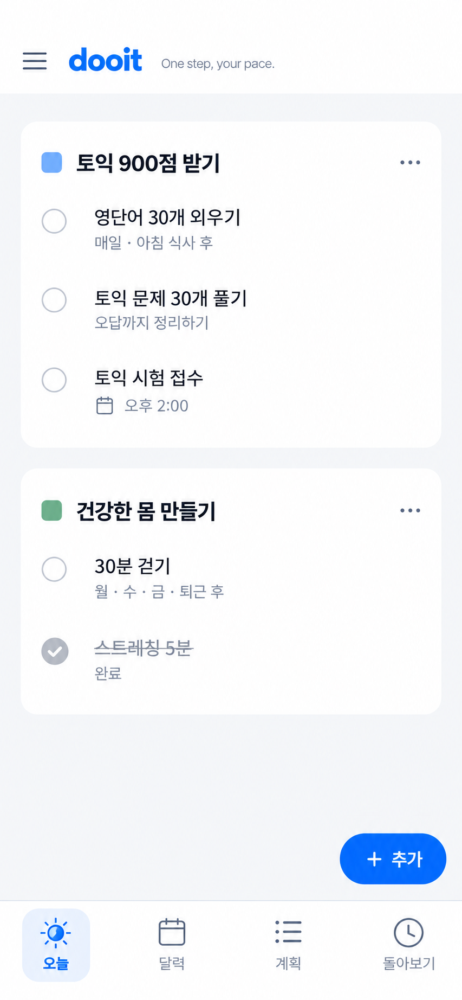

# 목표 묶음 중심 디자인 — 과거 참조 오류 기록

2026-10-21 정정: 아래 카드형 이미지를 ‘3번’으로 연결한 것은 구현 측 참조 오류다. **현재 구현 기준은 [사용자가 첨부한 흰 배경·색상 레일 원본](../goal-lanes-correction-2026-10-21/README.md)**이다. 아래 시안·규칙은 `479ae87` 당시 이력이며 최신 기준을 덮어쓰지 않는다. 외부 스킬/디자인 자료를 확인한 기록은 재사용한다.

원본 `exec-126a00cb-bf17-4c8c-b706-cd99abd03f24.png`. 실제 앱 캡처가 아니다.

## 디자인의 목적

앱을 열면 자신의 목표와 그 아래 오늘 할 일이 먼저 읽혀야 한다. 목표를 구성하는 반복·일회성 일·일정은 한 묶음에서 다루고, 완료는 실제 기록으로 남긴다. 정보가 적을 때 장식이나 임의의 통계로 공간을 채우지 않는다.

- 목표당 하나의 흰 surface. 항목마다 카드, 중첩 카드, 가로 구분선, 그림자를 추가하지 않는다.
- 주목할 것은 목표명과 할 일이다. 브랜드 파랑은 로고·활성 탐색·주요 행동에 사용하고 보조 정보는 중립 회색으로 낮춘다.
- 색 마커와 목표명을 함께 표시한다. 색만으로 의미를 전달하지 않는다.
- 작은 영문/한국어 문구는 로고 옆에 둔다. 명언을 큰 배너나 실행 평가로 만들지 않는다.
- 오늘 제목·요일·상시 달력·달성 퍼센트·연속 기록 압박을 추가하지 않는다.

## 구현에 사용할 공통 규칙

| 요소        | 기준                                                   | 이유                                                   |
| ----------- | ------------------------------------------------------ | ------------------------------------------------------ |
| 바탕 / 묶음 | `#F5F6F8` / 흰색, dark는 기존 theme의 대응 surface     | 테두리 없이 목표 관계를 구분                           |
| 글자        | 본문 16/24, 보조 13/18, 목표 제목 18/26 semibold       | 전체 크기를 키우지 않고 위계를 만듦                    |
| 글자 색     | 본문 `#20242C`, 보조 `#626C7B`, muted `#68717E`        | 파란 보조 정보와 활성 행동의 혼동 감소                 |
| 묶음        | 바깥 20(좁은 화면 16), 내부 16, radius 18, 묶음 간 16  | 한 목표 아래 목록을 자연스럽게 묶음                    |
| 목록        | 최소 64 높이, checkbox 22, 조작 영역 최소 44           | 간단한 체크와 긴 제목을 함께 수용                      |
| 메타 정보   | 제목 아래 정렬, 있는 값만 노출                         | 제목/시각이 한 줄에서 경쟁하지 않음                    |
| 헤더        | 기존 52 + native safe area                             | 생성 이미지의 불필요한 상단 여백을 복제하지 않음       |
| 탭          | 72 + native safe area, icon 24, label 12/18, 선택 배경 | 항목별 규칙과 명확한 현재 위치, 글자 확대 시 높이 증가 |
| 추가        | 최소 48 높이, 내용과 겹치지 않는 하단 공간             | 터치 위치를 유지하면서 목록을 가리지 않음              |

폰트는 현재 플랫폼 기본 sans-serif와 기존 dooit wordmark를 사용한다. 생성 이미지에서 정확한 폰트 파일을 확인할 수 없으므로 특정 폰트와 완전 일치한다고 주장하지 않는다. 장식용 raster asset이 없어 새 이미지/폰트 의존성을 추가하지 않는다. 기존 Feather/SF Symbols를 활용한다.

## 화면별 확장안과 완료 기준

| 화면        | 수정 방향                                                                                               | 실제로 확인할 상태                                      |
| ----------- | ------------------------------------------------------------------------------------------------------- | ------------------------------------------------------- |
| 오늘        | 목표 묶음과 세로 메타 정보, 일정/일반 일도 같은 행 규칙. 미연결 일은 중립 묶음                          | 항목 0/1/여러 개, 긴 제목, 체크 직후, 오류, 320/390/430 |
| 계획        | 목표 가로 탭 유지. 선택 목표 개요와 항목 목록을 하나의 주영역으로 정리. 관리 메뉴는 제목 옆             | 목표 전환, 반복/일정/일회성 혼합, 순서 편집, 목표 0개   |
| 상세        | 제목·완료·연결 목표·날짜 우선. 빈 설명/0개 체크리스트는 작은 추가 행동으로, 값 없는 메타는 편집 시 노출 | 없는 값, 긴 설명, 체크리스트 있음/없음, 되돌리기        |
| 작성/수정   | 필수 입력 먼저, 반복·알림·기타 설정은 점진 노출. 첫 오류 필드로 복귀                                    | 키보드, 제출 중, 실패 후 초안, 충돌, 취소               |
| 달력        | 날짜 선택 영역과 선택일 목록의 균형. 이전/다음 이동 단위를 분명히                                       | 한 달 경계, 일정이 많은 날/없는 날, 오늘 복귀           |
| 돌아보기    | 실제 목표별 기록과 구체적 행동. 차트·숫자로 채우기보다 기록을 읽을 수 있게                              | 기록 0개/소수/많음, 취소된 기록, 기간 변경              |
| 검색/기록함 | 같은 행·글자·색 체계, 검색 대상과 저장 목적지 명확화                                                    | 목표 이름 검색, 결과 없음, 필터, 오늘 이동              |
| 계정/설정   | 관련 설정만 한 묶음. 안내와 오류를 구분하고 게스트 경고의 과도한 강조 감소                              | 게스트/계정, 저장 실패, 보조 화면 복귀                  |

계획의 가로 목표 탭 등 이미 선택한 정보 구조는 유지한다. 달력 모드나 작성 흐름 등 새 구조가 필요한 곳만 별도 비교 후 결정한다. 디자인 우선순위는 **오늘·공통 탐색 → 계획·상세 → 작성 → 달력·돌아보기 → 보조 화면**이다.

## 추가 스킬 및 자료 교차 검토

공식 목록과 설치된 plugin 목록을 확인했다. 이 환경에는 독립적인 `frontend-design` 또는 `codex-design` 이름의 설치된 스킬이 없었다. Product Design/Figma는 설치되어 있다. 외부 원문을 읽어 다음 기준을 적용했으며 새 스킬을 설치했다고 표현하지 않는다.

| 자료                                                                                                           | 적용                                                                            | 이 앱에 그대로 적용하지 않을 부분                                                             |
| -------------------------------------------------------------------------------------------------------------- | ------------------------------------------------------------------------------- | --------------------------------------------------------------------------------------------- |
| [Anthropic frontend-design](https://github.com/anthropics/skills/blob/main/skills/frontend-design/SKILL.md)    | 제품 내용에 맞는 위계, 절제된 강조, 명확한 버튼/빈 상태 문구, 구현 후 자기 검토 | 마케팅 hero나 개성 연출을 위해 선택 시안을 바꾸지 않음                                        |
| [Vercel React Native Skills](https://github.com/vercel-labs/agent-skills/tree/main/skills/react-native-skills) | Pressable, gap/padding 분리, continuous radius, 목록 성능·safe area 검토        | iOS 전용 inset 방식을 Web/Android에 일괄 적용하거나 새 목록 라이브러리를 무조건 도입하지 않음 |
| [Web Interface Guidelines](https://github.com/vercel-labs/web-interface-guidelines/blob/main/command.md)       | 명확한 이름/역할/선택 상태, focus, 긴 글자, 입력 오류, 화면을 가리는 고정 요소  | DOM/CSS/Next.js 규칙을 native API로 오인하지 않음                                             |

Product Design은 선택 이미지의 구현과 실제 화면 비교를 담당한다. 위 자료는 각각 미감·native 구현·Web 접근성의 추가 검토 관점이다. 도구 개수나 자동 검사 통과를 디자인 완성도로 간주하지 않는다.

네이버/배민은 이전 턴에 확인한 공식 [네이버 앱 소개](https://apps.apple.com/kr/app/id393499958), [배민 앱 소개](https://apps.apple.com/kr/app/id378084485)의 공개 이미지와 [우아한형제들 디자인 시스템 글](https://techblog.woowahan.com/6305/)을 참고했다. 두 native 앱을 직접 사용한 감사나 Figma 파일 검토는 아니다.

## 기능이 비어 보이는 이유 — 디자인 다음에 연결할 것

| 흐름                       | 현재 근거                                                  | 사용자에게 생기는 끊김                             | 필요한 연결                                                |
| -------------------------- | ---------------------------------------------------------- | -------------------------------------------------- | ---------------------------------------------------------- |
| 계획 → 오늘                | `useTodayOverview`는 Task를 조회하고 새 회차 hook은 미연결 | 매일 계획을 만들어도 오늘에 나타나지 않음          | F3a-2 회차 조회/Task 중복 제거/기본·최소·휴식              |
| 목표 → 일반 일             | `TodayOverview` 그룹은 기존 `ddayGoalId`만 사용            | 새 Goal과 일반 일이 한 묶음으로 보이지 않음        | 새 Goal ID를 구분한 제목·색·목록 연결                      |
| 오늘 목표 → 계획           | 제목을 눌러 `/plan`으로만 이동                             | 누른 목표와 다른 선택 목표가 열릴 수 있음          | 목표 key를 전달하고 올바른 목표를 선택                     |
| 오늘 추가 → 오늘 목록      | 빠른 작성 기본 목적지는 기록함                             | 추가한 일을 오늘에서 찾기 어려움                   | 목적지 명시, 한 동작으로 오늘 배치, 부분 성공 재시도       |
| 체크 → 기록                | 오늘은 미완료 목록만 표시                                  | 다 끝낸 날이 처음 시작하는 날과 같아 보임          | 같은 묶음의 실제 완료 표시/취소, 완료한 날 안내            |
| Goal → 전체 구성           | G-07 전체 Task 목록 계약 미합의                            | 반복만 보여 목표의 일회성 일/일정을 관리할 수 없음 | 서버 목록 계약 확인, 전체처럼 보이는 부분 목록 금지        |
| 완료 → 돌아보기            | 현재 Task 기록 중심                                        | 목표를 향해 온 과정이 흩어져 보임                  | Goal Journey/직접 기록 연결, 실제 사실만 요약              |
| 작은 행동/휴식 → 다음 기회 | API 기반은 있으나 오늘 UI 미연결                           | 부담을 낮추고 다시 돌아올 경로가 없음              | 행의 맥락 메뉴, 명시적 취소·충돌 복구, 다음 행동 선택 입력 |

위 항목은 코드/이전 실제 감사의 확인 사항이며 신규 기능 완료가 아니다. Goal과 D-Day의 숫자 ID를 합치지 않는다. 서버에 없는 통계·제목·성과를 채워 시안을 꾸미지 않는다.

## 이번 첫 구현 범위

오늘의 **기존 실제 Task 묶음 표현**과 공통 탭/글자 색부터 적용한다. 새 Goal 회차·완료 목록·Goal 이동 맥락은 위 후속 기능으로 구분한다. 시안의 5개 예시 항목이 자동 생성되거나 실제 API에 저장되지는 않는다.

영향 플랫폼은 Android/iOS/Web이다. 실제 화면 검토는 로컬 mock Web에서 수행하고 native safe area·글자 확대·VoiceOver/TalkBack은 미검증으로 기록한다. 전체 시안의 기능 연결 완료와 이 첫 시각 보정을 구분한다.
