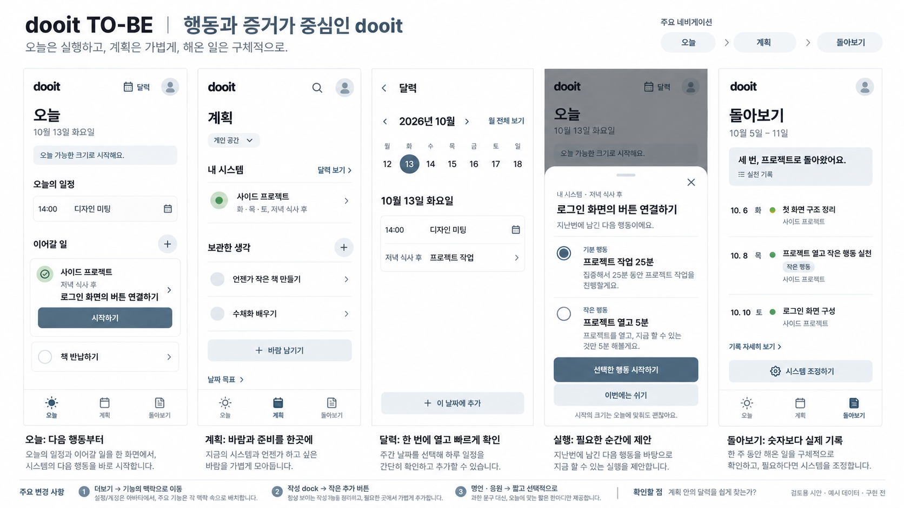
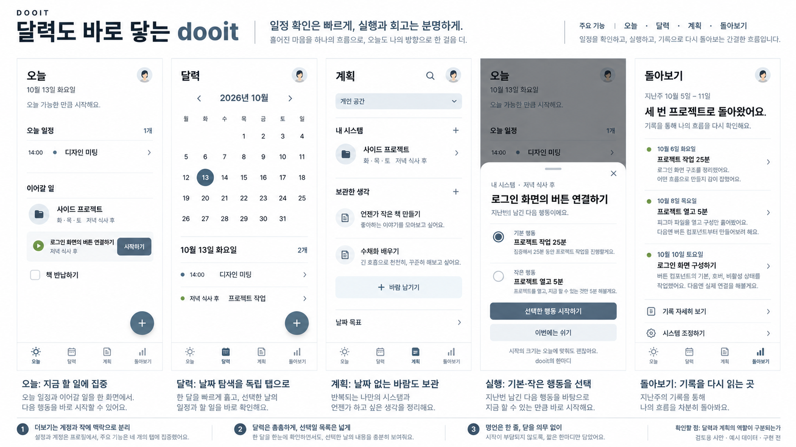
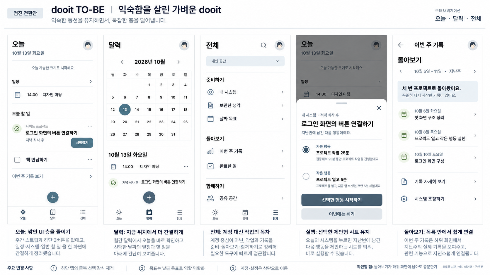

# Dooit TO-BE 화면 제안 보드

작성: 2026-10-13 · 상태: 1번 구조 + 2번 시각 스타일 조합 선택, 조합 시안 검토 전 · 앱 구현 없음

[전체 구조 검토](../../product/PRODUCT_ARCHITECTURE_REVIEW_2026-10-13.md)의 세 가지 탐색 구조를 계획서 형식으로 시각화했다. 한 보드에 같은 방향의 주요 화면 5개와 수정 이유를 배치했다. 모든 기록은 예시이며 실제 사용자 데이터가 아니다. Product Design ideate와 built-in ImageGen을 사용했으며 [전체 프롬프트](./PROMPTS.md)를 함께 보존한다.

## 사용자 선택

2026-10-13 사용자가 1번의 오늘·계획·돌아보기 구조와 2번의 간결한 시각 스타일을 조합하는 방향을 선택했다. 실행 sheet는 기존 선택을 유지한다. [일상 반복 행동 점검](../../product/DAILY_SYSTEM_FIT_REVIEW_2026-10-13.md)에 따라 운동·영단어·순환 동기 문구를 조합 시안에 반영한다. 세 안 중 다시 선택을 요구하지 않는다. 조합 이미지와 생성·실천·휴식·오류 상세는 구현 전에 검토한다.

후속 범위 보충: [목표 여정 명세](../../product/GOAL_JOURNEY_EXPERIENCE.md)에 따라 목표 상세·여러 반복 계획·일회성 노력·목표별 지나온 길이 필요하다. 아래 보드에는 이 핵심 화면이 빠져 있어 최종 전체 앱 명세로 간주하지 않는다. 선택한 구조/스타일은 유지하고 조합 시안에 이 흐름을 추가한다.

## 표시 순서와 비교

이번 대화에서 이미지가 표시된 순서를 따른다. 기존 시스템 시각안의 3번 선택과 이번 보드 번호는 별개다. 기존 선택인 제안형 실행 sheet는 세 보드 모두 유지한다.

| 번호 | 파일·방향                  | 검토 문서와 대응           | 주요 판단                                                                    |
| ---- | -------------------------- | -------------------------- | ---------------------------------------------------------------------------- |
| 1    | 행동과 증거가 중심인 dooit | B, 오늘·계획·돌아보기      | 우선 추천 구조. 달력은 명시적 바로가기. 계획 아래 달력 발견 가능성 검증 필요 |
| 2    | 달력도 바로 닿는 dooit     | C, 오늘·달력·계획·돌아보기 | 달력 사용 비중이 높은 경우의 4탭. 달력과 계획 역할 구분 필요                 |
| 3    | 익숙함을 살린 가벼운 dooit | A, 오늘·달력·전체          | 기존 경로를 유지하는 전환안. 돌아보기는 여전히 하위 화면                     |

## 1. 행동과 증거가 중심인 dooit

오늘, 계획, 달력 하위 화면, 실행 sheet, 돌아보기를 보여준다. 달력 바로가기와 계정 진입은 상단에 둔다. 목록에 다음 행동을 보이고 기본·작은 행동은 실행할 때 선택한다.

## 2. 달력도 바로 닿는 dooit

오늘, 달력, 계획, 실행 sheet, 돌아보기를 보여준다. 월 달력 아래 선택일 목록이 같은 화면에 보이도록 밀도를 조정한다. 네 목적지에 독립적인 역할이 충분한지 비교한다.

## 3. 익숙함을 살린 가벼운 dooit

오늘, 달력, 전체, 실행 sheet, 돌아보기를 보여준다. 전체는 계정 카드 대신 준비·기록·공유 기능의 목차가 된다. 회고가 하위에 남는 비용을 검토한다.

## 생성 결과 검토와 수정할 세부 사항

이미지 3개를 직접 확인했다. 주요 탐색 차이, Today의 주간 strip 제외, 간결한 작성 진입, 선택된 실행 sheet, 주간 원본 기록은 표현됐다. 생성 이미지는 구현 명세·접근성 통과 판정이 아니다. 아래 사항은 선택 후 정밀 화면에서 수정한다.

- 1번은 header의 dooit 로고가 반복되고 일부 행의 card 테두리·바람 추가 진입이 중복된다. 화면명 중심 header, 대표 추가 진입으로 더 줄일 수 있다.
- 1·3번의 예정 시스템 옆 체크 아이콘은 이미 실천한 상태로 오해할 수 있다. 예정은 중립 아이콘으로, 완료는 실제 확인 뒤 표시해야 한다.
- 2번은 생성기가 예시 메모에 피곤함·실천 시간을 추가했다. 실제 제품에서는 사용자 원본 메모가 있을 때만 이런 표현을 보여준다. 실행 예정 시간에서 실천 시간을 추정하거나 감정을 AI가 만들어내면 안 된다.
- 3번은 회고 상단에 이번 주와 지난주가 함께 보인다. 선택한 기간과 제목을 일치시켜야 한다. 하단 설명의 주간 strip 제거 표현도 현재 구현의 사실과 다르다. 최신 Today에는 이미 strip이 없고 새 안에서도 유지하지 않는다는 의미로 읽어야 한다.
- 세 보드의 Today에는 10월 13일 화요일, 증거에는 지난주 10월 5–11일 예시를 사용했다. 월 달력은 10월 1일 목요일 기준이다.
- 캘린더 아이콘을 계획에도 사용하는 등 일부 icon 의미가 유사하다. 선택안 구현 전 icon family·의미·label을 정밀화한다.
- 장문 명언 대신 짧은 자체 응원을 예시로 넣었다. 명언 원문·출처 검증, 숨기기와 잠깐 쉬어가기 상세 화면은 다음 화면 설계에 포함한다.
- 전체 앱 검토 방향을 대표 화면으로 보여주는 보드다. 시스템 생성, 실천 확인·다음 행동 입력, 실패·휴식·복귀, 계정·Workspace 상세까지 모두 그린 최종 화면 명세는 아니다.

선택된 조합으로 생성·실천 확인·회고의 정상/빈 상태/오류를 확대 설계한다. 화면의 위치·역할과 시각 디테일은 별도로 판단할 수 있으며 여러 안의 요소를 조합하면 조합 시안을 먼저 확인한다. 아직 앱 코드·의존성·백엔드 계약은 변경하지 않았다.
