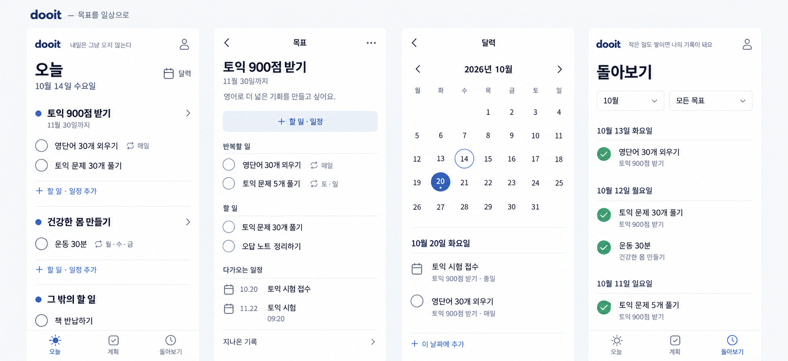

# 목표 중심 전체 화면 수정안

2026-10-14 · built-in ImageGen · 사용자 확인 전

이전 Today 조합 시안은 사용자에게 거절됐다. 목표 아래 반복 할 일·일회성 할 일·일정을 묶고 체크로 완료한다. 동기 문구는 상단 dooit 옆에 작게 배치한다. 실천하기 버튼·추가 노력 분류·임의의 목표 달성률을 사용하지 않는다.



오늘·목표 상세·달력·돌아보기의 단일 방향 이미지다. 계획 루트와 작성 화면은 별도 설계가 필요하다. 모든 데이터는 예시이며 실제 구현 화면이 아니다. 생성 이미지의 반복 계획 정의 옆 체크박스는 실제 구현에서 오늘 회차 완료와 혼동되지 않도록 구분해야 한다.

## 생성 프롬프트

```text
Create ONE coherent redesign presentation image for the Korean mobile productivity app dooit, showing FOUR app screens side by side as a single whole-app design concept. This is one revised direction, not alternative concepts. Image aspect ratio landscape about 2.2:1, high resolution 2400x1100. Each screen is a natural 390x844 mobile viewport rendered proportionately, with legible Korean text. No device bezels, status bars, phone shadows, or browser chrome. Outside screens use a very light neutral presentation background and a small restrained heading "dooit — 목표를 일상으로". Avoid explanatory paragraphs.
Core product: goals contain recurring tasks, one-off tasks, and dated events. Today groups due tasks under their parent goal. Checking the empty circle completes an item. NO "실천하기" buttons, NO "추가 노력" labels, NO progress percentages, NO progress bars, NO streak counters, NO "시스템" jargon. A goal's actual achievement is user-confirmed, never inferred from task counts. NO giant motivation banner. Motivation is a tiny quiet sentence immediately beside the small dooit wordmark in a compact top brand row.
Design direction: genuinely refined native task app, clean flat white surfaces, charcoal type, muted slate blue selected state, hairline separators, very restrained green for checked items only. Existing Dooit uses slate blue, white, Korean sans-serif and simple outline icons; retain that palette and recognizable wordmark but substantially improve spacing and hierarchy. No gradients, textures, shadows, giant icons, card piles, decorative illustrations, emojis, or oversized headers. Korean Pretendard-like sans-serif, body 14–16px at logical viewport. 20px horizontal margins, compact content, generous breathing space BELOW short lists rather than expanding all rows to fill height. Rounded rectangles only for small controls. Each goal is a typographic section, not a giant bordered card.
Date anchor: Today is Wednesday 2026-10-14. All dates/weekday labels must be correct.
Screen 1 TODAY:
Compact top row "dooit" left in small bold wordmark, tiny muted motivational sentence immediately beside it "내일은 그냥 오지 않는다", small profile icon far right. Below, heading "오늘", subline "10월 14일 수요일", on right outline calendar icon + text "달력".
First goal section title "토익 900점 받기" with small goal icon or tiny slate dot, small secondary deadline "11월 30일까지", subtle chevron to goal detail.
Under this goal only: empty circle checkbox row "영단어 30개 외우기" with tiny repeat icon and secondary "매일"; empty circle checkbox row "토익 문제 30개 풀기" with NO extra label. Then pale muted compact text action "+ 할 일 · 일정 추가".
Second goal section "건강한 몸 만들기"; empty circle "운동 30분", secondary "월·수·금".
Separate section "그 밖의 할 일"; empty circle "책 반납하기". It MUST be visually outside the TOEIC goal.
Bottom nav exactly "오늘" "계획" "돌아보기", tasteful consistent outline sun/checklist/history icons, Today selected. No floating big plus and no bottom capture dock.
Screen 2 GOAL DETAIL:
Top small back arrow + title "목표", overflow menu. Heading "토익 900점 받기", secondary "11월 30일까지". Small personal note "영어로 더 넓은 기회를 만들고 싶어요."
One compact primary add control "+ 할 일 · 일정". Then section "반복할 일": empty circle "영단어 30개 외우기" / "매일"; empty circle "토익 문제 5개 풀기" / "토·일".
Section "할 일": empty circle "토익 문제 30개 풀기"; empty circle "오답 노트 정리하기".
Section "다가오는 일정": calendar/date marker "10.20" and "토익 시험 접수"; another "11.22" and "토익 시험" with "09:20".
Bottom quiet navigable row "지나온 기록" with chevron. Goal detail is a pushed screen, no bottom nav required. A dated event is visually distinct from a task checkbox, while belonging to same goal.
Screen 3 CALENDAR:
Small back arrow + "달력". Compact month header "2026년 10월" with prev/next chevrons.
Elegant compact month grid, Monday-first headers "월 화 수 목 금 토 일". Exact grid: first row blank blank blank 1 2 3 4; second 5 6 7 8 9 10 11; third 12 13 14 15 16 17 18; fourth 19 20 21 22 23 24 25; fifth 26 27 28 29 30 31 blank. Mark today 14 with thin subtle outline, selected 20 with slate blue filled circle. Tiny event dot on 20.
Below header "10월 20일 화요일". Event row calendar icon "토익 시험 접수", secondary "토익 900점 받기 · 종일". Task row empty circle "영단어 30개 외우기", secondary "토익 900점 받기 · 매일". Compact text action "+ 이 날짜에 추가". This is calendar via Today top shortcut, not a fourth main tab.
Screen 4 HISTORY:
Same compact dooit top row with a tiny restrained line beside it "작은 일도 쌓이면 나의 기록이 돼요". Heading "돌아보기". Simple period control "10월" and small goal filter "모든 목표".
An honest chronological completed activity list with goal context, no artificial summary or percentage. Date section "10월 13일 화요일"; small checked circle "영단어 30개 외우기", secondary "토익 900점 받기". Date "10월 12일 월요일"; checked circle "토익 문제 30개 풀기", secondary "토익 900점 받기"; checked circle "운동 30분", secondary "건강한 몸 만들기". Date "10월 11일 일요일"; checked circle "토익 문제 5개 풀기", secondary "토익 900점 받기".
Bottom nav exactly "오늘" "계획" "돌아보기", History selected.
The design must communicate a simple familiar checkbox productivity app with meaningful goal grouping, not a coaching dashboard. Crisp editorial hierarchy and natural small controls. Preserve all important Korean labels correctly. The user rejected the previous screen as ugly and overcomplicated: make this visibly simpler and more polished. No giant quote panel, no "오늘의 문장" label, no quote refresh button taking attention, no "추가 노력", no "실천하기", no percentage.
```
