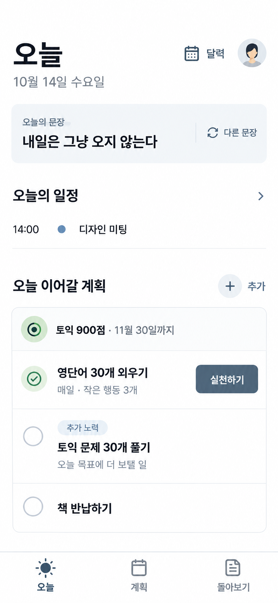

# Today 선택 조합 시안

작성: 2026-10-14 · 상태: 후속 재탐색 1번 선택 · 프론트 구현 중

사용자가 선택한 [1번의 `오늘 · 계획 · 돌아보기` 구조와 2번의 간결한 목록·여백](../to-be-2026-10-13/README.md)을 하나의 Today 화면으로 합쳤다. Product Design ideate와 built-in ImageGen으로 만들었으며 현재 앱과 앞선 두 보드의 실제 이미지를 참고 자료로 첨부했다.

## 화면에서 확정하려는 것

- 하단의 주 목적지를 `오늘 · 계획 · 돌아보기` 세 개로 줄인다.
- 달력은 독립 탭 대신 Today 상단의 명시적 바로가기로 둔다.
- 짧은 순환 동기 문구를 일정과 행동보다 앞에 두되 화면의 주인공이 되지 않게 한다.
- `목표 → 오늘의 반복 계획 → 목표에 보탤 일회성 노력` 관계를 한 목록에서 읽게 한다.
- 여러 유형을 늘어놓던 하단 작성 dock 대신 섹션의 `추가` 한 곳에서 현재 맥락에 맞게 시작한다.

## 구현 전에 보정할 것

생성 이미지의 크기는 853×1844이며 390×844 화면 비율을 따른다. 실제 구현에서는 저장소 token과 native font scale을 사용하고 390dp뿐 아니라 320·430dp도 확인한다. 이미지의 녹색 체크 모양은 완료 표시로 오해할 수 있으므로 예정된 반복 계획에는 중립적인 계획 아이콘을 쓴다. `내일은 그냥 오지 않는다`는 출처를 붙이지 않는 제품 문구 후보로 취급하며, 문구 목록·교체 주기·숨기기 정책은 별도로 구현한다.

이 시안은 Today 기본 상태의 구조와 시각 밀도를 정하는 자료다. 실행 sheet, 계획 작성, 목표 상세, 돌아보기의 정상·빈 상태·실패 상태는 각각 별도 시각 검토 후 구현한다.

후속 비교에서 사용자는 [운영 앱 참고 재탐색 1번](./TODAY_REFERENCE_INSPIRED_OPTIONS.md)을 선택했다. 실제 구현 기준은 해당 문서와 `11-today-reference-inspired-option-1.png`이며, 이 페이지 상단의 초기 조합 이미지는 결정 과정 기록으로 남긴다.
