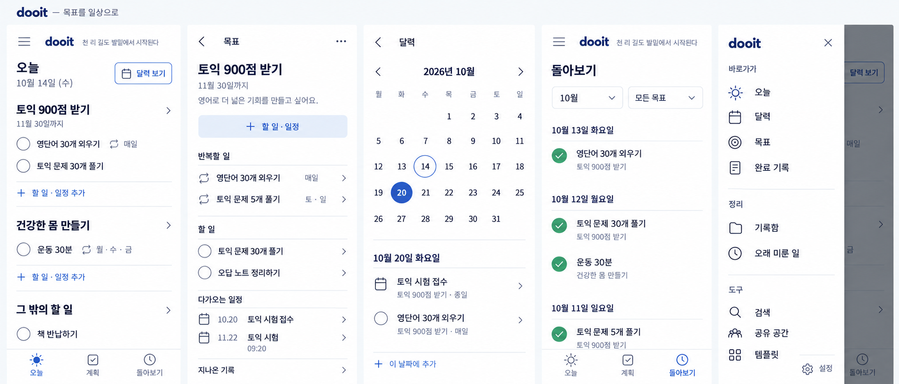

# 상단·탐색 보완 이미지

2026-10-14 · built-in ImageGen · 구현 전 시안



목표별 체크 목록을 유지하고 작은 Today 제목, 명시적인 달력 보기 버튼, 좌측 메뉴를 반영했다. 문구는 노자 도덕경 64장을 직접 번역한 후보다. 사용자의 지시에 따라 이번 이미지 작업에서 검증 명령은 실행하지 않았다.

## 생성 프롬프트

```text
Create a refined revision of the attached dooit whole-app UI board, keeping the approved goal-grouped task structure and clean white/slate-blue design. ONE unified design concept, not multiple alternatives. Landscape high resolution 2800x1200 approximately, five equal mobile viewports side by side, each naturally proportioned 390x844. Small board title "dooit — 목표를 일상으로". Screens are app content only, no devices, OS status bars, notches or shadows. Crisp legible Korean typography.

Reference image is the approved structural starting point. Preserve goal hierarchy, task labels, dates and calm flat list style. Essential changes: restore the top-left hamburger menu, reduce oversized page headings, make calendar access an unmistakable labeled outlined button, and replace example slogan with a sourced short quote. Do not add dashboards or embellishments. No progress percentages/bars, no "실천하기", no "추가 노력", no big motivational card.

Common top header for Today and Review: left hamburger icon, then small bold "dooit", then one quiet small single line "천 리 길도 발밑에서 시작된다". The quote is a direct Korean rendering of Laozi Dao De Jing chapter 64; attribution is available upon tap in implementation, not a big visible UI block. Remove separate profile icon to avoid clutter. Header about 52 logical pixels tall, quote 12px, logo 19px. Page heading "오늘" is only 20px, NOT a hero title. Date is 13px. Body 14-16px. Touch controls 44px target. 20px side margins, consistent 1px outline icons, minimal borders except dividers and the calendar button. White, charcoal/navy text, muted slate-blue actions, green only for actually completed checkmarks.

Screen 1 TODAY:
common top header. Next compact row: left "오늘 · 10월 14일 (수)" with Today modestly bold and date muted; right a clearly outlined rounded rectangular button with calendar icon + "달력 보기". Keep readable, fit naturally, can date sit just beneath Today within the same compact row if needed but NO giant heading.
Goal section "토익 900점 받기", secondary "11월 30일까지", chevron.
Empty checkbox rows "영단어 30개 외우기" with small repeat icon/"매일"; "토익 문제 30개 풀기". Subtle "+ 할 일 · 일정 추가".
Goal "건강한 몸 만들기"; empty checkbox "운동 30분", small repeat/"월·수·금"; subtle add.
Separate "그 밖의 할 일", empty checkbox "책 반납하기". Plenty of clear separation without boxes around goals.
Bottom tab icons and labels exactly "오늘" "계획" "돌아보기", Today selected.

Screen 2 GOAL DETAIL:
small back arrow header "목표" and overflow.
Heading "토익 900점 받기" about 22px, date "11월 30일까지", personal note "영어로 더 넓은 기회를 만들고 싶어요."
Compact "+ 할 일 · 일정".
Section "반복할 일": use neutral repeat icons (NOT checkbox circles, these are recurring-plan definitions not today's completion) and chevrons for editing: "영단어 30개 외우기" / "매일"; "토익 문제 5개 풀기" / "토·일".
Section "할 일": empty checkbox "토익 문제 30개 풀기", empty checkbox "오답 노트 정리하기".
Section "다가오는 일정": calendar glyph "10.20 토익 시험 접수"; calendar glyph "11.22 토익 시험" / "09:20".
Footer row "지나온 기록" chevron. No bottom nav necessary on this pushed detail.

Screen 3 CALENDAR:
back arrow header "달력". Month "2026년 10월", left/right arrows.
Exact Monday-first weekday headers 월 화 수 목 금 토 일.
Month dates grid first row blanks Mon Tue Wed, then Thu1 Fri2 Sat3 Sun4; second 5 6 7 8 9 10 11; third 12 13 14 15 16 17 18; fourth 19 20 21 22 23 24 25; fifth 26 27 28 29 30 31 blank.
Today Oct14 outlined, selected Oct20 slate filled circle.
Below "10월 20일 화요일"; calendar/event row "토익 시험 접수", secondary "토익 900점 받기 · 종일"; empty checkbox "영단어 30개 외우기", secondary "토익 900점 받기 · 매일"; "+ 이 날짜에 추가".
No bottom nav on calendar pushed screen.

Screen 4 REVIEW:
common header with menu, small dooit and same quote.
Modest 20px heading "돌아보기". Two compact selectors "10월", "모든 목표".
Completed history with small green checked circles: "10월 13일 화요일" / "영단어 30개 외우기" / goal "토익 900점 받기"; "10월 12일 월요일" / "토익 문제 30개 풀기" goal TOEIC and "운동 30분" goal "건강한 몸 만들기"; "10월 11일 일요일" / "토익 문제 5개 풀기" goal TOEIC.
Bottom three tabs Today/Plan/Review, Review selected. No fabricated prose summary.

Screen 5 LEFT DRAWER OPEN:
show Today screen dimmed behind a LEFT slide-in white navigation panel covering roughly 82% width. Clearly a drawer, not a full-page new tab. Panel header small "dooit", close x. Simple neatly spaced icon+label menu rows, compact section headers:
"바로가기": "오늘", "달력", "목표", "완료 기록".
"정리": "기록함", "오래 미룬 일".
"도구": "검색", "공유 공간", "템플릿".
Bottom divider and "설정".
No invented avatars or user names. All rows fit naturally and retain 44px-ish tap targets. This shows existing access routes retained while the main nav stays visible in the app.

Current date 2026-10-14 Wednesday. All mock history is prior to today. Preserve exact labels, clean alignment, consistent icon and text weights. No excessive bullet circles beside goal headings; goal typography and a small chevron suffice. Focus visual quality on reduced header height, smaller typography, functional hierarchy, clean navigation. The board should feel like a coherent desirable real app, not a wireframe or presentation covered in annotations.
```
