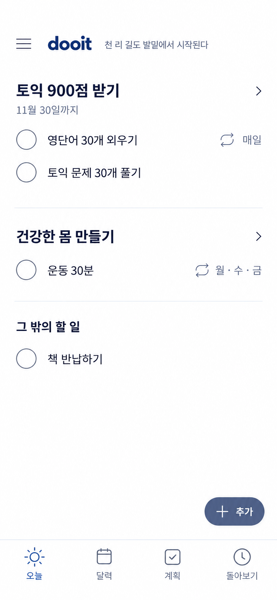

# Today: 달력 탭과 단일 추가

2026-10-14 · built-in ImageGen · 사용자 확인 전



최신 사용자 피드백이 앞선 세 탭·상단 달력·날짜·그룹별 추가 정책보다 우선한다. 하단은 오늘·달력·계획·돌아보기 순서로 제안한다. 오늘과 다른 날짜 확인을 인접하게 둔 제품 판단이며 사용자 테스트 결과는 아니다. 본문의 오늘 제목·현재 날짜·요일과 상단 달력 버튼을 없앤다. 목표 자체의 목표일은 유지한다.

추가는 오른쪽 아래 하나로 합친다. 누르면 할 일·일정 유형과 연결할 목표를 선택할 수 있는 작성 화면을 연다. Today에서는 목표를 임의로 추측하지 않고 목표 선택 또는 연결 안 함을 명시한다. 목표 상세에서 진입하면 해당 목표를 기본값으로 표시한다. 목록 끝에 충분한 여백을 두어 추가 버튼이 마지막 항목을 가리지 않게 한다.

## 참고한 자료와 확인 범위

- [Todoist Quick Add](https://www.todoist.com/help/todoist/features/use-task-quick-add-in-todoist-va4Lhpzz): 한 작성 진입에서 날짜 등 세부 속성을 함께 입력하는 방식.
- [Things 제스처](https://culturedcode.com/things/support/articles/2803582/): 단일 Magic Plus를 통한 추가. 드래그 자체는 이번 구현 요구가 아니다.
- [Things 반복](https://culturedcode.com/things/support/articles/2803564/): 반복 정의와 Today에 나타나는 개별 회차 구분.
- [Material 탐색](https://m2.material.io/design/navigation/): 모바일 최상위 목적지의 하단 탐색 원칙. M3 페이지는 동적 본문을 확인하지 못했으므로 세부 규칙의 근거로 사용하지 않았다.

이번에는 공식 문서 검색과 기존 시안 이미지, Product Design 지침을 참고했다. 타사 앱을 직접 조작하거나 Figma 파일을 열어 검토한 것은 아니다. 새 시안은 앱 구현 완료 화면이 아니며 사용자 지시에 따라 검증 명령은 실행하지 않았다.

## 생성 프롬프트

```text
Revise the attached dooit Today screen into ONE refined mobile UI image. 390x844 logical viewport portrait, render high resolution. Actual app content only, no phone, presentation board, status bar, browser, notch or home indicator. Keep approved goal-grouped checkbox list and compact menu/brand/quote header.

MANDATORY CHANGES:
1. Remove ENTIRE date/weekday row and top calendar button. NO current date or weekday anywhere in header/body. NO page title "오늘". Word "오늘" appears ONLY as the bottom selected tab.
2. Bottom nav now FOUR equal tabs in this exact left-to-right order: "오늘" (sun), "달력" (calendar), "계획" (checklist), "돌아보기" (history). Today selected. Four real destination tabs, no central add tab.
3. Remove ALL repeated per-goal "+ 할 일 · 일정 추가" and "+ 할 일 추가" links. No per-section plus signs or buttons anywhere.
4. ONE global add control only: tasteful small floating pill button at bottom right ABOVE the navigation, exact "+ 추가", dark muted slate-blue fill, white plus and label. 48px tall, about 90px wide, 20px from right and 18px above nav. It must sit in blank space with no obscured list item. This opens a task/event composer with explicit goal selector (composer NOT visible in this image).

Visual refinement: restrained native productivity app, white background, dark charcoal/navy body text, muted slate-blue controls, no electric blue, no gradient, no decorative texture, almost no shadow, no nested cards, no giant bold typography. Reference shows text too large and controls too heavy: use 15px regular task titles, 16px semibold goal headings, 12px quiet metadata, 20px bold dooit wordmark. 20px horizontal padding. Quiet hierarchy and clean exact alignment.
Header 60px approx: 22px hamburger icon left (44px touch area), compact "dooit", then very small muted quote "천 리 길도 발밑에서 시작된다" beside logo in one line. No avatar. Header leads directly into goal content after a 20px gap, NO blank removed-date-sized gap.

Goal 1 header "토익 900점 받기" with subtle small chevron at right. Optional goal-specific deadline "11월 30일까지" at 12px gray beneath (this is the goal target date, NOT today's date, retain it).
Two rows each about 52px: empty 22px thin gray circle checkbox, "영단어 30개 외우기", right small repeat icon and "매일"; empty checkbox "토익 문제 30개 풀기".
No add link. One faint divider and 24px gap separates goal groups, no row borders.

Goal 2 header "건강한 몸 만들기" and small chevron.
Empty checkbox "운동 30분", right tiny repeat icon and "월·수·금".
No add link. One faint divider and gap.

Group 3 heading "그 밖의 할 일" in subdued 14px medium, no chevron.
Empty checkbox "책 반납하기".
No add link.

These are the only four task rows. Leave natural generous blank white space below; do not invent extra tasks, summaries, streaks or artwork and do not stretch each row into oversized blocks.
Bottom anchored FOUR-tab bar 70px approx, subtle hairline top edge, consistent 21px icons, 11px text. "오늘" selected muted slate-blue, inactive gray. Add pill floats above bar without overlapping items.

Preserve simple checkbox completion, goal context and quiet motivation. NO progress percentages, no "실천하기", no "추가 노력", no top calendar shortcut, no date/weekday title, no oversized Today heading, no repetitive creation links. Current date anchor 2026-10-14 but DO NOT SHOW current date. Single beautiful polished production-quality Korean app screen.
```
