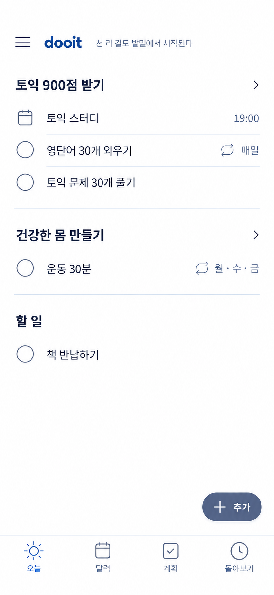
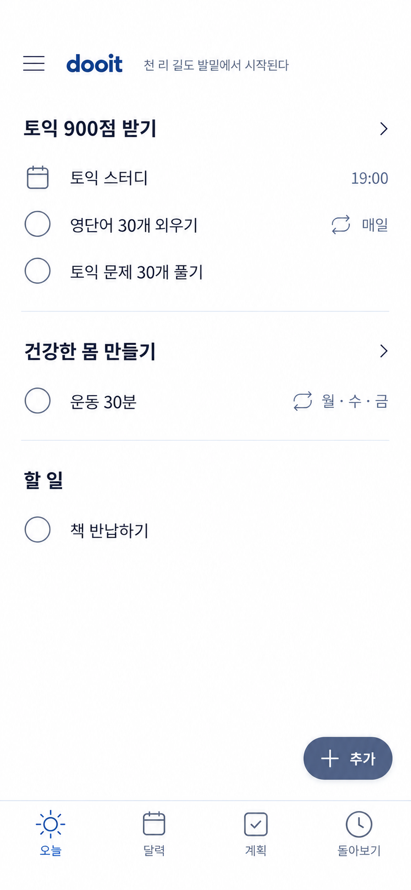

# Today 최종 제안

2026-10-14 · 디자인 최종 제안, 사용자 확정·구현 전



최신 보정에서는 같은 목표 안의 일정·할 일 사이에 본문 열부터 시작하는 옅은 구분선을 넣었다. 목표 그룹 사이는 더 긴 선과 여백으로 구분한다. 항목이나 목표를 카드로 감싸지는 않는다. 아래 이미지는 구분선 보정 전 구조 기록으로 남긴다.



## 이번 결정

- 목표에 연결하지 않은 Task 묶음은 '할 일'로 표현한다. '그 밖의', '기타', '미분류'처럼 남은 항목이라는 인상을 주는 이름은 쓰지 않는다.
- 목표가 연결된 항목은 목표 제목 아래에, 목표 없는 할 일은 동등한 목록으로 둔다.
- 현재 날짜·요일·본문 오늘 제목은 제거한다. 목표 마감일도 목표 상세에서 확인하게 하고 Today에는 해당일의 항목만 보여준다.
- 오늘 예정된 일정도 목표 아래에 넣는다. 일정은 달력 아이콘과 시작 시간, 할 일은 체크박스로 구별한다. 종일 일정은 '종일'로 표시한다. 시간 경과로 완료 처리하지 않는다.
- 목표 없는 일정이 있으면 조건부 '일정' 그룹에 표시한다. 이 상태의 이미지는 이번 예시에 포함하지 않았다.
- 목표 상세 진입은 목표 제목 행 전체, 완료는 체크 영역, 항목 편집은 항목 본문으로 구분한다.
- 하단 오늘·달력·계획·돌아보기 순서, 단일 추가 버튼, 좌측 메뉴와 작은 문구를 유지한다.
- 같은 목표 안의 항목은 체크박스·아이콘 뒤에서 시작하는 옅은 구분선으로 나눈다. 목표 그룹 사이는 전체 폭에 가까운 선과 더 큰 여백으로 구분해 정보 계층을 드러낸다.

## 기능 점검과 구현 기준

1. 노출 대상: 해당 사용자 현지 날짜에 예정된 반복 회차·일회성 할 일·일정. 목표 목록 전체나 미래 일정까지 Today에 펼치지 않는다.
2. 순서: 사용자가 설정한 목표 순서를 유지한다. 각 목표 안의 일정은 시작 시간순, 할 일은 사용자 순서로 표시한다. 체크 직후 다른 목표까지 재정렬하지 않는다.
3. 완료: 체크 시 해당 회차만 완료한다. 즉시 실행 취소를 제공하고, 당일 완료 항목은 접힌 '완료한 일'에서 다시 열어 취소할 수 있다. 완료 항목이 없으면 섹션을 만들지 않는다. 기록은 돌아보기에서도 확인한다.
4. 일정: 누르면 시간·장소 등 상세를 연다. 완료 가능한 기존 일정의 완료/취소 기능은 상세에서 유지한다. 예정 시각이나 종료 시각만으로 실천 증거를 생성하지 않는다.
5. 반복: 항목 메뉴에서 이번만 건너뛰기·날짜 조정·반복 수정 경로를 제공한다. 건너뜀은 완료와 구분하고 실패나 연속 기록 손실을 강조하지 않는다.
6. 지난 항목: 누락분을 오늘 목록에 강제로 누적하지 않는다. 기존 메뉴의 재검토 경로에서 확인·이동·종료한다. 자동 이월 정책은 API와 정합성을 맞춘다.
7. 추가: Today에서는 할 일/일정과 연결 목표를 선택하며 목표 없음도 허용한다. 목표 상세 진입에서는 해당 목표를 기본값으로 명시한다. 날짜가 필요한 일정은 선택한 날짜·시간을 저장 전에 보여준다.
8. 상태: 그룹에 항목이 없으면 제목도 숨긴다. 전체 빈 상태에서는 '할 일을 가볍게 남겨보세요'와 동일한 단일 추가 버튼을 제공한다. 저장 실패 시 입력을 보존하고 해당 항목에서 재시도한다.
9. 접근성: 작은 체크 도형과 별개로 터치 영역 최소 44dp를 확보한다. 긴 제목은 줄바꿈하고 반복·시간 정보가 제목을 가리지 않게 한다. 추가 버튼 아래 스크롤 여백을 확보한다.
10. 문구: 상단에서 짧게 읽고 탭으로 출처·다른 문장·숨기기에 접근한다. 사용 중 자동 교체하지 않는다.

완료 접기, 실행 취소, 작성, 빈 상태·오류, 건너뛰기는 이번 정적 시안에 그려지지 않은 구현 기준이다. API 변경이 필요한 반복 회차 상태는 전달한 요청서와 계약 회신에 맞춰 구현하며 UI만으로 지원 완료를 선언하지 않는다.

## 검토 범위

직전 생성 시안에서 명칭·정보 우선순위·일정 누락을 점검한 디자인 검토다. 실제 앱의 조작 감사나 접근성 통과 판정이 아니다. 앞선 [공식 자료 조사](./TODAY_CALENDAR_TAB.md)를 이어 사용했으며 이번에 새 Figma 자료를 열지는 않았다. 사용자 요청대로 검증 명령을 실행하지 않았다.

built-in ImageGen을 사용했고 토익 스터디 19:00을 포함한 데이터는 모두 예시다. 아래 프롬프트와 실제 이미지를 함께 보존한다.

## 생성 프롬프트

```text
Create a final proposed Today screen design for Korean app dooit, refining the ATTACHED previous mockup. ONE single portrait 390x844 logical mobile app viewport, high resolution. App content only, no board, phone bezel, OS status bar, notch, home indicator or browser chrome. This is a careful incremental final polish of the selected direction, not a new design.

Keep: compact hamburger + dooit + short quote header, flat white background, goal-grouped list with simple checkboxes, ONE global "+ 추가" button bottom right, FOUR bottom tabs exactly "오늘", "달력", "계획", "돌아보기". Today selected.
REMOVE: "그 밖의 할 일" terminology, current date/day/page title, goal deadline subtitle "11월30일까지" (goal deadline is available in goal detail), all repeated per-goal add buttons. NO progress bars, percentages, streaks, achievements, coaching controls or decorative cards.

Visual target: quieter and more precise than attached. Current attached mock feels oversized; REDUCE logo, headings, checkboxes and row text to realistic native sizes. At logical width 390: logo 19px, goal headings 16px semibold, task text 15px regular, metadata 11px, checkbox 20px stroke 1.2. Header 56px. 20px side padding. Goal names not heavy black headlines; use readable charcoal. Neutral muted slate blue, no saturated electric blue. Body white, metadata medium gray, thin separators only BETWEEN groups. No shadows except optional almost imperceptible add control elevation. Flat modern outline icons consistent 20-22px.

HEADER: hamburger icon left, lowercase "dooit", tiny 11px single-line muted quote to right: "천 리 길도 발밑에서 시작된다". NO other header buttons, no calendar header action, no Today heading, no date. Goal content starts naturally about 24px below header, no hero-sized whitespace.

GROUP ONE:
header "토익 900점 받기" left with small chevron far right to access goal detail. No subtitle date.
First row is a SCHEDULED EVENT linked to this goal: at left a small calendar-outline icon instead of a checkbox, main text "토익 스터디", at right restrained slate-blue time "19:00". This is a mock appointment scheduled for today, and must read as an event that can be opened, not a completed task. Same typography and row rhythm as tasks.
Second row: empty circle checkbox, text "영단어 30개 외우기", right small repeat icon + "매일".
Third row: empty circle checkbox, text "토익 문제 30개 풀기", no right metadata.
Each row around 48-52px logical height, all main texts align exactly after icon gutter. Clear spacing between goal heading and first row. NO per-row chevrons, no per-row outlines. One subtle divider after goal group.

GROUP TWO:
header "건강한 몸 만들기" with small chevron at far right.
One empty checkbox row "운동 30분", right small repeat icon + "월·수·금".
Subtle separator after group.

GROUP THREE:
simple heading "할 일" (exactly these two words, NOT "그 밖의", "기타", "미분류", "개인 할 일", "자유 할 일"). Same respectful hierarchy, no chevron because it is a grouping not a goal destination.
One empty checkbox row "책 반납하기". No metadata.
No add links below any group.

Below lists, deliberate generous blank whitespace. No false completed row, counters, empty-state art or motivational panel. Do not expand row heights to fill all space.

GLOBAL ACTION: one compact dark slate-blue rounded pill "+ 추가" in lower right, logical height48 width88, 20px inset right and 18px above bottom tab bar. White label and plus. Enough list bottom padding so content will scroll clear of button in implementation. NOT a fifth tab.

BOTTOM NAV: 4 equal-width destinations, white base and fine gray top divider, restrained slate-blue selected Today sun outline, gray others. Exact left-right "오늘" "달력" "계획" "돌아보기". Consistent 21px icons: sun, calendar, checklist, history. Labels 11px. Total height about72px. NO filled pill behind selected icon.

Date anchor 2026-10-14, all visible task/event examples refer to today, but no current date displayed. Scheduled study is mock data. Quote already source checked (Laozi chapter64 Korean rendering); attribution opens on quote tap, not visible now.
Preserve exact Korean copy, clean line spacing, realistic text sizes, no clipped content. User requests final focused Today UI: goal-linked tasks and appointments coexist naturally, unlinked tasks are called simply "할 일", creation consolidated, no clutter.
```
