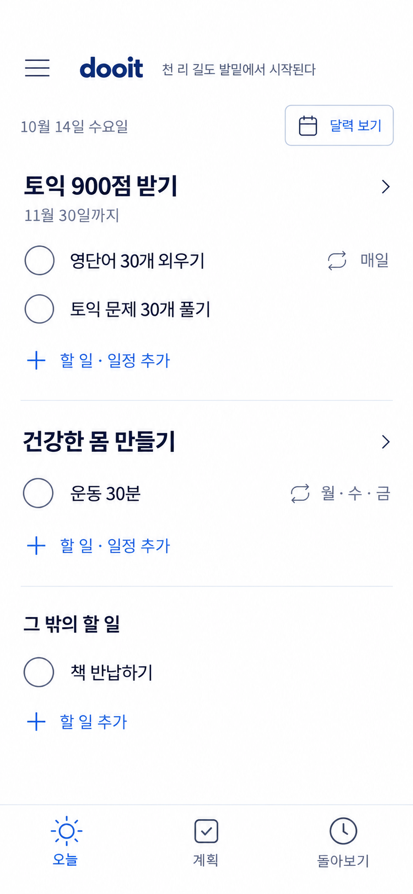

# Today 제목 제거 시안

2026-10-14 · built-in ImageGen · 앱 구현 전



본문의 오늘 제목을 제거하고 상단 날짜·요일과 달력 보기를 배치했다. 오늘 명칭은 선택된 하단 탭에만 남겼다. 목표별 체크 목록·메뉴·작은 문구를 유지한다. 사용자 요청에 따라 검증 명령은 실행하지 않았다.

## 프롬프트

```text
Create ONE refined single-screen mobile UI mockup for dooit, focused ONLY on the Today tab. Revise the leftmost screen of the attached reference. Output portrait 390x844 logical viewport, high resolution. No surrounding presentation board, no other screens, no device bezel, OS status bar, notch, browser chrome or shadows.

The user explicitly requests NO "오늘" heading in the page body: the selected bottom tab already labels it. This is the most critical requirement. The ONLY occurrence of "오늘" should be the selected bottom navigation label. Show only a SMALL date and weekday near the top, "10월 14일 수요일", logical 13px muted gray. No hero title, no welcome heading, no giant date.

Maintain the approved idea: goals group their recurring and one-off tasks; completion is via simple checkbox. No progress percentages, progress bars, streaks, coaching cards, "실천하기", "추가 노력", or nested bordered cards. Keep restrained navy/slate-blue Dooit identity but improve visual quality dramatically through typography, alignment and spacing. Pure white flat canvas, charcoal primary text, muted cool-gray metadata, restrained slate-blue controls. Native Korean sans-serif like Pretendard, task titles 15px regular/medium, goal titles 17px semibold. No excessive bold text or bright electric blue.

Top app bar about 56px tall: left hamburger menu 22px outline icon within a 44px tap area; then compact lowercase bold wordmark "dooit" at 20px; immediately to its right tiny 11–12px muted quote "천 리 길도 발밑에서 시작된다". Keep quote unobtrusive, one line. No avatar, no quote box, no quote label.

Next compact utility row: left small date "10월 14일 수요일"; right a subtle compact pale-neutral outlined rounded button with calendar icon and exact label "달력 보기". Button has 44px touch target but visual weight secondary. Row does not look like a page hero. Goal list begins soon below it with 20–24px gap. 20px horizontal margins.

Goal group 1:
Header "토익 900점 받기" with small chevron to right; below title muted 12px "11월 30일까지". Header does NOT have a colored bullet, big icon, card background or border.
Within the group, two aligned comfortable 52px rows with 22px thin outline EMPTY checkbox circles:
"영단어 30개 외우기", tiny repeat glyph and small metadata "매일" aligned at right.
"토익 문제 30개 풀기", no badge or meta needed.
A single quiet inline action below at text indentation: plus icon and "할 일 · 일정 추가", 13px muted slate-blue. No full-width button, no separate boxed bar.
Do not place a divider around every row; use only one very light separator AFTER the entire goal group with generous vertical spacing.

Goal group 2:
Header "건강한 몸 만들기" with small chevron.
One task row empty checkbox "운동 30분", tiny repeat glyph with "월·수·금" aligned right.
Same quiet inline "할 일 · 일정 추가". Slight space and one hairline separator after group.

Other tasks:
Header "그 밖의 할 일" in 15px medium, lower emphasis than goal names, no chevron because it is a grouping not a goal detail.
Empty checkbox row "책 반납하기".
Quiet inline "+ 할 일 추가".
Leave comfortable blank breathing space below the list; do not stretch groups excessively to consume all space, no extra content or empty state.
No floating add button, no redundant global add button.

Bottom fixed navigation about 68px plus safe padding, white with subtle top divider. EXACTLY three evenly distributed icons + small 11px labels: "오늘" (selected restrained slate-blue sun outline icon), "계획" (checklist outline icon), "돌아보기" (history outline icon). Consistent icon sizes 22px. No selected giant circle, no solid tab pill. This is the ONLY location of the word "오늘".

Critical invariants: small date at top and absolutely NO Today body heading; left menu remains visible; motivation beside dooit remains small; explicit calendar button; preserve goal-task grouping and simple check completion. Use the provided image as continuity reference but specifically remove the large Today header and reduce heavy typography, excess lines and repeated button weight. Render Korean accurately. Current date anchor 2026-10-14 Wednesday. App content only, one single polished native screen.
```
