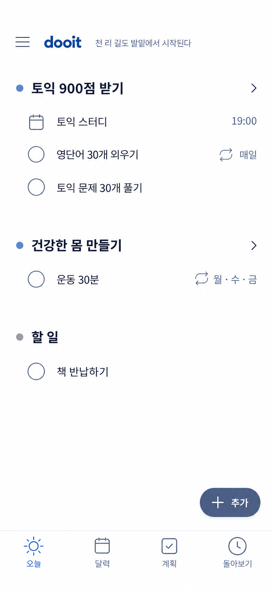
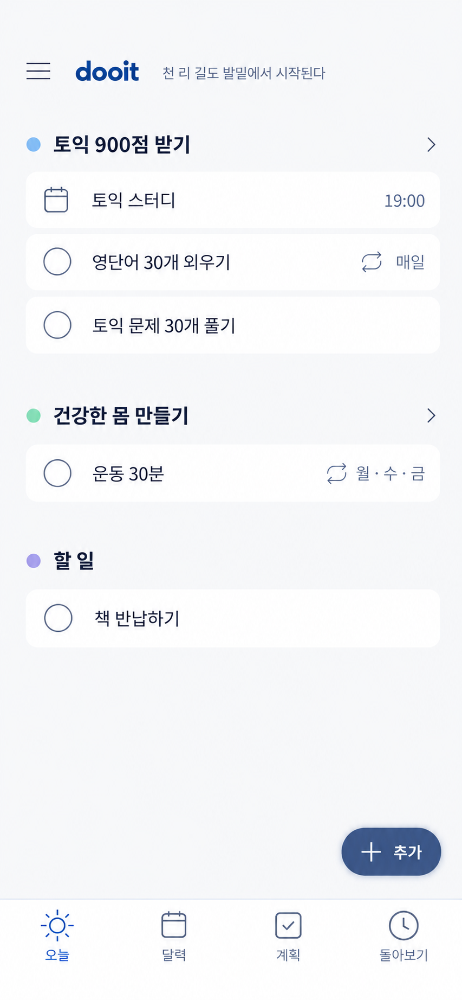
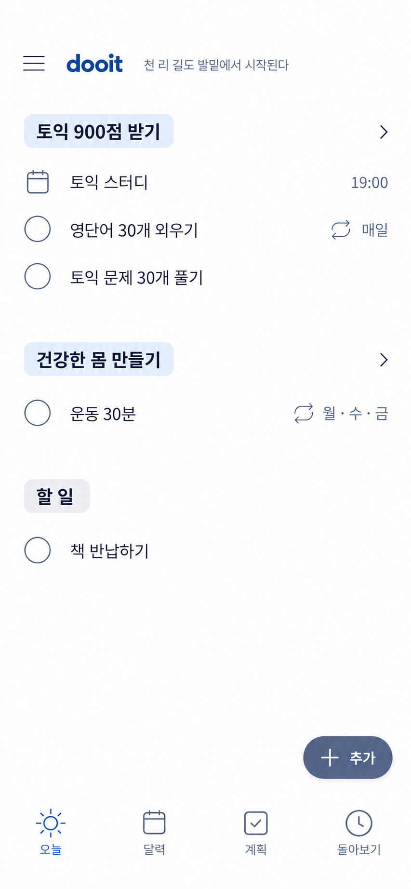

# 운영 앱 참고 Today 재탐색

2026-10-14 · Product Design 시각 비교 · 1번 선택, 프론트 구현 중

앞선 카드·트리·헤더 띠 안이 모두 다소 무겁다는 피드백에 따라, 공식 제품 자료에서 확인한 목록 구성 원칙을 Dooit의 목표 구조에 맞춰 다시 탐색했다.

- [Things](https://culturedcode.com/things/features/): Today에서 일정과 할 일을 함께 보여주고, 헤딩과 여백으로 구조를 만든다.
- [Apple Reminders](https://support.apple.com/en-za/guide/iphone/iph82596cb20/27/ios/27): 섹션 아래에 할 일을 조직하고 접거나 재배치할 수 있다.
- [Todoist Today](https://www.todoist.com/help/todoist/get-started/plan-your-day-with-the-today-view-UVUXaiSs): 여러 프로젝트에서 오늘 날짜에 해당하는 작업을 한 화면에 모은다.

공식 페이지와 설명은 확인했지만 내장 브라우저를 사용할 수 없어 실제 앱 조작 캡처는 만들지 못했다. 아래 시안은 해당 앱을 복제한 것이 아니라 확인한 구성 원칙을 기존 Dooit 시안에 적용한 비교안이다.

## 1

사용자 선택안이다. 카드·구분선 대신 작은 목표 색상 점, 들여쓰기, 여백으로 목표와 하위 항목을 구분한다. 목표 생성 시 여섯 색 중 하나를 고르며 색상은 현재 프론트 로컬 설정으로 저장한다. 서버 Goal 계약에 색상 필드가 확정되면 계정 동기화 값으로 이전한다.

## 2

## 3

세 안 모두 목표·하위 일정과 할 일·목표 없는 할 일·단일 추가·하단 네 탭을 유지한다. 1번을 기준으로 Today 목표별 목록, 단일 추가 메뉴, 작은 순환 문구, `오늘 · 달력 · 계획 · 돌아보기` 탭과 목표 색상 선택을 구현하기 시작했다. 사용자 지시에 따라 검증 명령은 실행하지 않았다.
