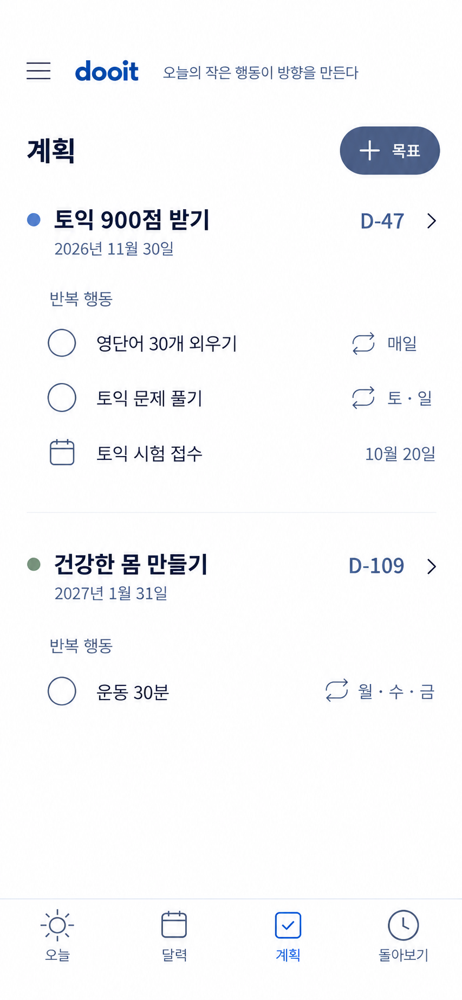
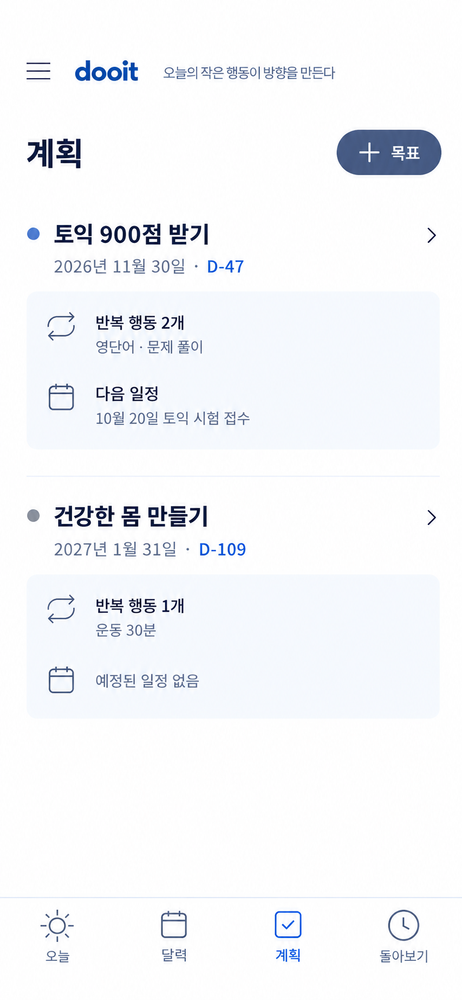
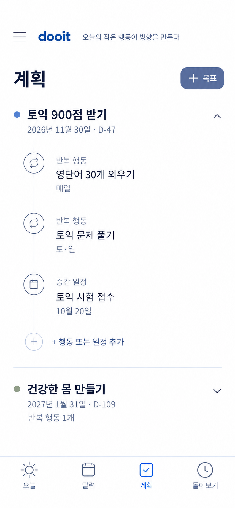
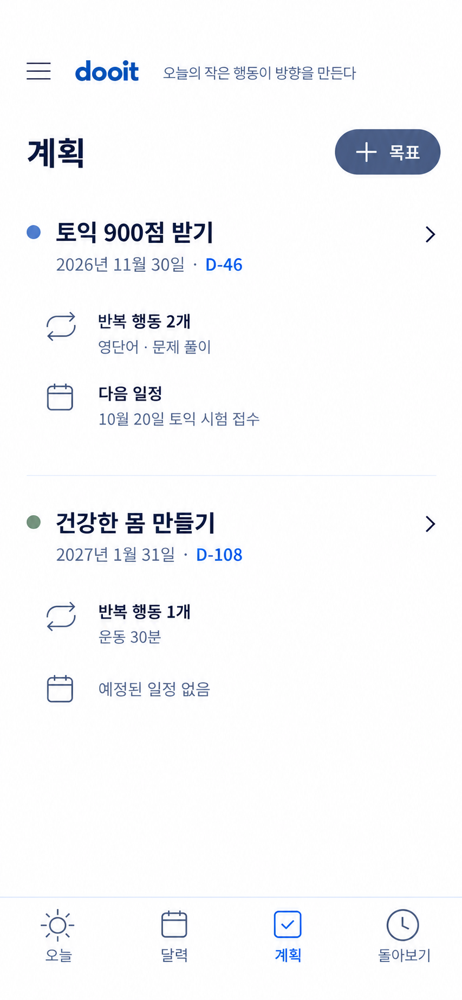

# 계획 탭 선택안

작성: 2026-10-15 · Product Design 비교 및 사용자 선택 · 프론트 구현 중

계획 탭은 Today의 체크 목록을 반복하지 않고, 목표를 이루기 위해 준비한 **목표일·반복 행동·중간 일정**을 관리하는 화면으로 정의한다.

## 비교안

### 1. 평면 목표 목록

Today와 시각적으로 가장 자연스럽게 이어지지만 반복 항목의 원형 표시가 체크박스로 읽혀 두 탭의 역할이 겹쳐 보일 수 있다.

### 2. 목표 설계 요약

각 목표의 반복 행동 수와 다음 일정을 요약해 계획 탭의 관리 역할이 가장 분명하다. 다만 옅은 요약 박스가 기존 Dooit보다 무겁다.

### 3. 목표 로드맵

목표 안의 행동과 일정 순서를 이해하기 쉽지만 세로선이 단계 진행률로 오해될 수 있고 목표가 많아질수록 길어진다.

## 선택한 조합

사용자는 **2번의 정보 구조와 1번의 평평한 표현** 조합을 선택했다.

- Today: 오늘 발생한 할 일과 일정의 실행·완료
- 계획: 목표일, 반복 행동, 예정된 중간 일정의 구성·관리
- 달력: 날짜별 배치 확인·조정
- 돌아보기: 실제 완료 기록과 지나온 길 확인
- 계획 첫 화면에는 체크박스·달성률·연속 기록을 표시하지 않는다.
- 목표별로 색상, 목표일과 D-Day, 반복 행동 요약, 다음 일정을 표시한다.
- 목표를 펼치면 연결된 항목과 관리 행동을 확인한다.
- 신규 Goal 계약 전에는 기존 D-Day와 연결 Task에서 가능한 요약만 계산한다.
- 목표 색상은 백엔드 `colorKey` 계약 전까지 로컬 값을 사용하고, 계약 배포 후 서버 값으로 이전한다.

사용자 요청에 따라 `npm run validate`와 구현 후 실제 화면 감사는 이번 단계에서 실행하지 않는다.
